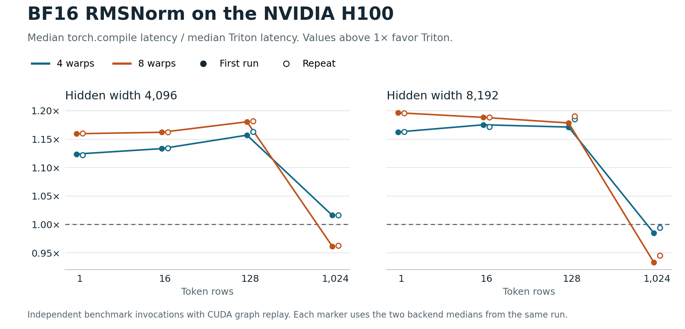

# H100 RMSNorm Lab

How much does the thread layout of a BF16 RMSNorm kernel matter on an NVIDIA H100? This inference microbenchmark varies the number of token rows while keeping the math and inputs fixed. The initial experiment compares a single-row Triton kernel with four or eight warps against eager PyTorch and shape-specialized TorchInductor.



## Findings

At hidden width 4096 and one token row, the eight-warp kernel took **1.82–1.83 µs** across two runs. Compiled PyTorch took **2.11–2.12 µs**, giving the Triton kernel about **14% lower latency**. At 1,024 rows and width 8192, compiled PyTorch led both custom kernels in both runs. The difference between four and eight warps changes sign as the number of rows grows.

Each cell below contains the first run's median GPU time in microseconds. Each timing sample averages 32 consecutive invocations in a CUDA graph. The raw files retain all 21 samples per implementation and shape.

| Token rows | Hidden width | PyTorch eager | PyTorch compiled | Triton 4 warps | Triton 8 warps |
| ---: | ---: | ---: | ---: | ---: | ---: |
| 1 | 4096 | 16.19 | 2.11 | 1.88 | **1.82** |
| 16 | 4096 | 24.57 | 2.20 | 1.94 | **1.89** |
| 128 | 4096 | 27.45 | 2.44 | 2.11 | **2.07** |
| 1024 | 4096 | 71.85 | 5.00 | **4.92** | 5.20 |
| 1 | 8192 | 16.75 | 2.55 | 2.19 | **2.13** |
| 16 | 8192 | 19.13 | 2.68 | 2.28 | **2.26** |
| 128 | 8192 | 26.58 | 3.04 | 2.60 | **2.58** |
| 1024 | 8192 | 144.21 | **8.36** | 8.49 | 8.96 |

[First run](results/h100.json) · [Repeat run](results/h100-repeat.json) · [Numerical checks](results/correctness.json)

## Reproduce on a GPU

The recorded runs used Linux, an H100 80GB HBM3, Python 3.12.16, PyTorch 2.7.1+cu128, Triton 3.3.1 and NVIDIA driver 550.144.03. A C compiler and a linkable CUDA driver library are required to build the Triton launchers. The compiled PyTorch baseline can also use a C++ toolchain.

```bash
python3 -m venv .venv
source .venv/bin/activate
python -m pip install -r requirements.txt --index-url https://download.pytorch.org/whl/cu128 --extra-index-url https://pypi.org/simple
python check.py
BENCH_REVISION=$(git rev-parse HEAD) python benchmark.py --compiled --output run.json
```

For a single shape, add `--rows 1 --widths 4096`. To regenerate the figure, install Matplotlib in a local plotting environment and run `python plot_results.py`.

## Kernel and measurement

- The baseline Triton program loads one contiguous row and the shared per-column weight. It accumulates the sum of squares in FP32, applies reciprocal RMS with epsilon 1e-6, multiplies by the weight and stores BF16 output. Masked loads support widths up to 16384. [Kernel](kernels.py)
- The initial eight numerical scenarios cover random signed weights, zero rows, tiny and large inputs, and widths on either side of a power of two. Both warp counts passed against an FP32 reference with relative tolerance 0.005 and absolute tolerance 0.000001. Each timed backend also passed a reference check at each measured shape. [Numerical harness](check.py)
- All implementations use the same seeded synthetic inputs and return a new output. Validation, JIT compilation and graph capture finish before timing. Each round shuffles backend order. CUDA events bracket the replay, and the raw JSON records the median, quartiles and per-round averages. [Benchmark harness](benchmark.py)
- Inputs reuse the same addresses without an explicit cache flush. GPU clocks were unmanaged. These measurements cover this operator and graph-replay workload. Model serving latency, cold-cache performance and FlashInfer performance remain open questions.

## Fused residual addition and RMSNorm

The next experiment fused two operations at width 4,096. At 1,024 rows, three H100 seeds measured 10.068–10.113 µs for Triton and 115.666–115.844 µs for eager PyTorch. A regression discovered in review showed that intermediate BF16 rounding matters. All four compiled comparators missed that strict numerical contract in every checkpoint. [Kernel report](experiments/rmsnorm-residual/REPORT.md) · [Code review](https://github.com/hyscodebase/h100-rmsnorm-lab/pull/8)

The in-place follow-up matched the released vLLM 0.10.0 CUDA operator at width 4,096. At 1,024 rows, the ordered warp-shuffle implementation lowered latency by 7.43–7.58% over three independent seeds with matching output bits. [Operator comparison, raw evidence and chart](experiments/rmsnorm-residual/vllm/SHUFFLE_REPORT.md)

The same kernel matched output bits at 256, 512 and 2,048 rows. Latency fell by 12.02–12.18% at 256 rows, 10.38–10.51% at 512 rows and 4.892–4.997% at 2,048 rows. The 128-row capture checks found differences in all three timing seeds and excluded those seeds before timing. [Row-count results, GPU samples and follow-up](experiments/rmsnorm-residual/vllm/TRANSFER_REPORT.md)

At 128 rows, reducing the two groups per lane independently resolved all 238 recorded bit differences. The new kernel matched the vLLM outputs in all seven checkpoints. Its latency improvement of 1.044–1.147% fell below the 5% threshold. [128-row report and replay evidence](experiments/rmsnorm-residual/vllm/SMALL_ROWS_REPORT.md)

A 16-warp implementation then kept the same ordered FP32 sum and matched vLLM bitwise in every checked case. At 128 rows, the three median latencies were 3.364–3.370 µs, about 15.8–16.0% lower than vLLM and 15.0–15.2% lower than the eight-warp kernel. [Three-way results, compiler evidence and chart](experiments/rmsnorm-residual/vllm/SMALL_ROWS_16W_REPORT.md)

In a sustained 8-stream workload with input restoration, the 16-warp kernel processed 41.254–41.526 million normalized rows per second. It led vLLM by 6.718–7.405% across three seeds and stayed within 0.6% of the 8-warp kernel. The in-window GPU activity medians were 100% in all nine backend-seed groups, with seven groups meeting the sample coverage requirement. [Sustained throughput and NVML record](experiments/rmsnorm-residual/vllm/SUSTAINED_128_REPORT.md)

## Sustained H100 compute

In 20 runs of a BF16 prefill projection, the H100 completed 1.50 million matrix products over 902.18 measured seconds. The 16,384-row shape reached a median of 682.19 TFLOP/s. Gaps in device sampling limited confirmation of sustained activity to eight runs. [Full results, throughput and resource charts](experiments/prefill-gemm/REPORT.md) · [Workload and protocol](experiments/prefill-gemm/README.md) · [Tracking issue](https://github.com/hyscodebase/h100-rmsnorm-lab/issues/3)

## Row tiling and the continuing experiment

Grouping two or four token rows per program passed all 60 numerical checks. At the 1024×8192 target, the fastest grouped variant took 8.63 and 8.59 µs across two runs. The best one-row variant took 8.46 and 8.39 µs. The default remains one row. [Row-tiling report](results/row-tiles/REPORT.md)

The five-width follow-up found one qualifying shape. At 1024×4104 the two-row, four-warp kernel reduced latency by 5.42–5.77% against the best one-row configuration in two independent processes. [Width-sweep results and reproduction](results/width-sweep/REPORT.md) · [Experiment PR](https://github.com/hyscodebase/h100-rmsnorm-lab/pull/2)

```bash
python3 lab.py init --plan plans/width-sweep.json
python3 lab.py step
python3 lab.py status
```

[PyTorch RMSNorm](https://docs.pytorch.org/docs/2.7/generated/torch.nn.RMSNorm.html) · [Triton reduction tutorial](https://triton-lang.org/main/getting-started/tutorials/05-layer-norm.html) · [FlashInfer RMSNorm](https://docs.flashinfer.ai/generated/flashinfer.norm.rmsnorm.html)
