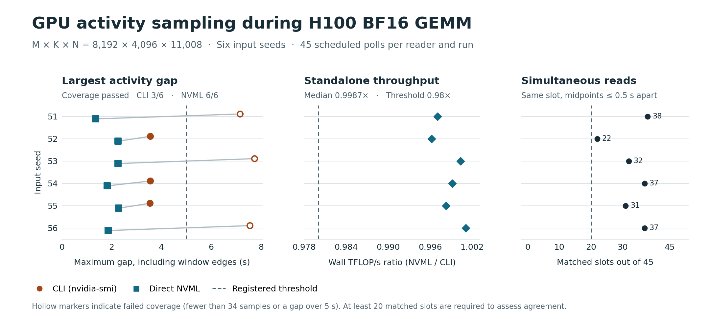

# Monitoring sustained BF16 matrix multiplication on H100

**Adopt the persistent NVML reader (B) for this H100, driver and projection shape.** Standalone B met activity coverage in 6/6 seeds and A in 3/6. The median paired B/A wall-throughput ratio was 0.99873. In the simultaneous arm, 6/6 seeds qualified for the activity agreement check. [Preregistered decision](../prefill-gemm/NEXT.md)

| Decision gate | Registered requirement | Observed | Outcome |
|---|---|---|---|
| Standalone coverage | B passes ≥5 seeds and ≥2 more than A | B 6/6, A 3/6, difference +3 | Pass |
| Standalone throughput | Median within-seed B/A ≥0.98 | 0.99873 | Pass |
| Simultaneous agreement | ≥4 seeds with ≥20 matched slots, each median absolute difference ≤5 pp | 6 eligible seeds, largest eligible median 0.00 pp | Pass |



## Measurements by seed

Each arm ran the same synthetic BF16 multiplication, with 8,192 token rows, input width 4,096 and output width 11,008. The 18 measured GEMM windows total **811.868 seconds** (0.22552 GPU-hours of measured wall time). Setup, warmup and cleanup are outside that total. Each checkpoint verified 256 output entries against a full-inner-dimension FP32 reference. The 45 planned slots start at one-second intervals. Coverage requires ≥34 valid activity samples and a maximum midpoint gap of ≤5 seconds, including both edges.

| Seed | A samples / max gap (s) | B samples / max gap (s) | A wall TFLOP/s | B wall TFLOP/s | B/A | C matched / unmatched slots | C median abs. difference (pp) |
|---:|---:|---:|---:|---:|---:|---:|---:|
| 51 | [38 / 7.156 (fail)](results/s51-A.json) | [45 / 1.366 (pass)](results/s51-B.json) | 681.23 | 679.23 | 0.99706 | [38 / 7](results/s51-C.json) | 0.00 |
| 52 | [40 / 3.554 (pass)](results/s52-A.json) | [43 / 2.261 (pass)](results/s52-B.json) | 682.12 | 679.51 | 0.99618 | [22 / 23](results/s52-C.json) | 0.00 |
| 53 | [28 / 7.744 (fail)](results/s53-A.json) | [43 / 2.258 (pass)](results/s53-B.json) | 681.73 | 681.97 | 1.00035 | [32 / 13](results/s53-C.json) | 0.00 |
| 54 | [36 / 3.559 (pass)](results/s54-A.json) | [44 / 1.826 (pass)](results/s54-B.json) | 683.47 | 682.90 | 0.99918 | [37 / 8](results/s54-C.json) | 0.00 |
| 55 | [40 / 3.540 (pass)](results/s55-A.json) | [43 / 2.281 (pass)](results/s55-B.json) | 683.00 | 681.82 | 0.99828 | [31 / 14](results/s55-C.json) | 0.00 |
| 56 | [37 / 7.550 (fail)](results/s56-A.json) | [44 / 1.858 (pass)](results/s56-B.json) | 682.49 | 683.23 | 1.00108 | [37 / 8](results/s56-C.json) | 0.00 |

In C, a matched slot has two valid activity readings with midpoints at most 0.5 seconds apart. The difference is expressed in percentage points and is reported only for seeds with at least 20 pairs.

## Poll outcomes and sampled device power

Power summaries use finite power readings returned within the measured window by each reader. The two C rows observe the same GPU and the same six intervals. Their wattages are reported separately. Means weight returned readings equally and peaks are the largest observed readings. These samples do not establish energy consumed between polls.

| Arm / reader | Valid activity | Skipped | Errors | Timeouts | Crossing end | Power readings / scheduled | Mean W | Observed peak W |
|---|---:|---:|---:|---:|---:|---:|---:|---:|
| A / cli | 219 | 47 | 0 | 3 | 1 | 219 / 270 | 699.07 | 703.01 |
| B / nvml | 262 | 8 | 0 | 0 | 0 | 262 / 270 | 698.70 | 700.55 |
| C / cli | 209 | 56 | 0 | 5 | 0 | 209 / 270 | 698.85 | 701.90 |
| C / nvml | 241 | 29 | 0 | 0 | 0 | 241 / 270 | 698.70 | 702.51 |

The readers draw from device-wide driver counters and the CLI reports GPU activity in integer percentage points. During sustained GEMM, readings near 100% provide limited resolution for differences between observers. Agreement on this high-load workload establishes neither independent ground truth nor accuracy during idle transitions. Simultaneous polling in C can affect query latency. The throughput gate uses the standalone arms only.

## Reproduction

GPU NVIDIA H100 80GB HBM3, driver 550.144.03, CUDA runtime 12.8, PyTorch 2.7.1+cu128, Python 3.12.16. Standalone A reported nvidia-smi 550.144.03 and standalone B reported NVML 12.550.144.03 via nvml-ctypes-v1. The six seeds are 51–56. The registered order balances each arm twice in each position. The run manifest is `09b3d5dbcbada428aa68099fb05a277cda7eedd3f6d257a11fddad797801ae26`. [Frozen source revision](https://github.com/hyscodebase/h100-rmsnorm-lab/commit/5bd202d11edce993949342e8b9fb4726a7407f5c) · [Source SHA-256 hashes](results/manifest.json) · [Checkpoint provenance](results/provenance) · [Controller attempts](results/attempts)

```bash
python3 experiments/observer/analyze.py experiments/observer/results
python3 experiments/observer/plot_results.py
```

The next kernel experiment compares fused residual addition and RMSNorm against compiled PyTorch under the same two-output contract. [Kernel PR #8](https://github.com/hyscodebase/h100-rmsnorm-lab/pull/8)
