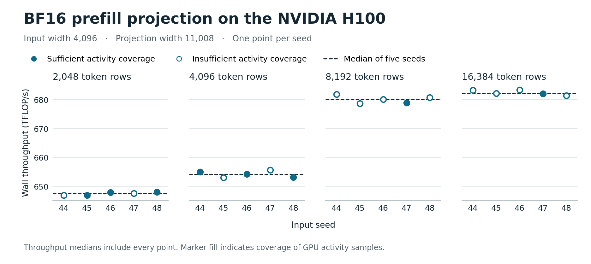
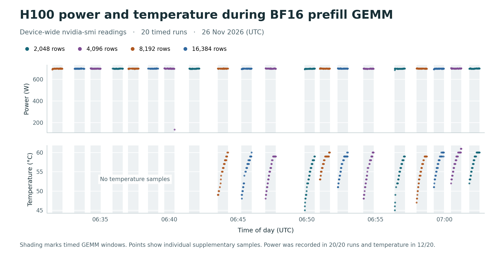

# H100 BF16 prefill projection results

The H100 completed **1,501,993 matrix multiplications in 902.18 measured seconds**. Across five seeds, throughput increased from 647.65 TFLOP/s at 2,048 token rows to 682.19 TFLOP/s at 16,384 rows. Device activity averaged 99.81–100.00% in the primary samples of each run. Sampling gaps limited the sustained-load conclusion. None of the four shapes met the threshold of four qualifying seeds. [Raw measurements](results) · [Run index](evidence/run-index.csv)

| Token rows | Median wall TFLOP/s across five seeds | Seeds with ≥95% mean activity and sufficient coverage |
| ---: | ---: | ---: |
| 2,048 | 647.65 | 3/5 |
| 4,096 | 654.28 | 3/5 |
| 8,192 | 680.10 | 1/5 |
| 16,384 | 682.19 | 1/5 |



## What the device recorded

- The primary collector returned **734 activity and power samples** and recorded **15 query errors**. Mean power across the 734 readings was **698.5 W**. Peak observed device memory ranged from 860 MiB in the smallest shape to 1,272 MiB in the largest. Device readings cover all work on the GPU. [Execution index](evidence/run-index.csv)
- Primary power samples support an estimated **479.5 kJ over 686.4 observed seconds**. The separate collector covered **758.0 seconds** and yielded **529.1 kJ**. Both estimates refer to the same workload. Each integrates adjacent valid power readings at most 2.5 seconds apart. The campaign's remaining intervals have unknown energy. [Energy calculation and sampling procedure](evidence/README.md)
- The supplementary collector captured **792 readings**. Temperature collection started with seed 46, so its **485 readings across 12 runs** cover the latter part of the campaign and span **45–61 °C**. One supplementary reading at 06:40:22.861 UTC reported 134.61 W and 0% GPU activity within the seed 45, 4,096-row window. The archive retains that point. [Seed 45 readings](evidence/supplemental/s45-m4096-k4096-n11008.csv)
- The point-in-time hardware and software record includes a 700 W enforced limit, NVIDIA driver 550.144.03, CUDA 12.8 and the cuBLAS runtime. [Environment snapshot](evidence/environment/20261126T064441Z.json)



## Accuracy, coverage and next decision

All 20 checkpoints passed the seeded FP32 comparison. Every run checked 16 sampled rows by 16 sampled columns using the entire reduction dimension, for **5,120 sampled output comparisons** overall. The campaign ran a contiguous BF16 prefill projection at fixed inner width 4,096 and output width 11,008 with a preallocated output. Shape order was fixed within every seed. The throughput figures describe this single operator and setup. [Method and tolerances](README.md)

To qualify, four of five seeds needed at least 95% mean device activity, at least 34 usable observations per run and gaps of at most five seconds including both window edges. The coverage conditions were added after reviewing the pilot and were applied to every raw run. Eight of 20 runs qualified individually. The longest gap was 9.28 seconds. The supplementary sensor readings remain available for resource accounting. [Experiment history](LOG.md)

The next experiment uses the 8,192-row workload and compares direct NVML polling with repeated nvidia-smi queries. It fixes the coverage, throughput and agreement criteria in advance and counterbalances run order across six fresh seeds. [Follow-up protocol](NEXT.md)

## Reproduce the report

From a checkout containing the recorded Git revisions, run the summary and regenerate the figures. The plotting commands use Matplotlib.

```bash
python3 experiments/prefill-gemm/summarize.py
python3 experiments/prefill-gemm/plot_results.py
python3 experiments/prefill-gemm/plot_usage.py --output experiments/prefill-gemm/evidence/device-usage.png
```
