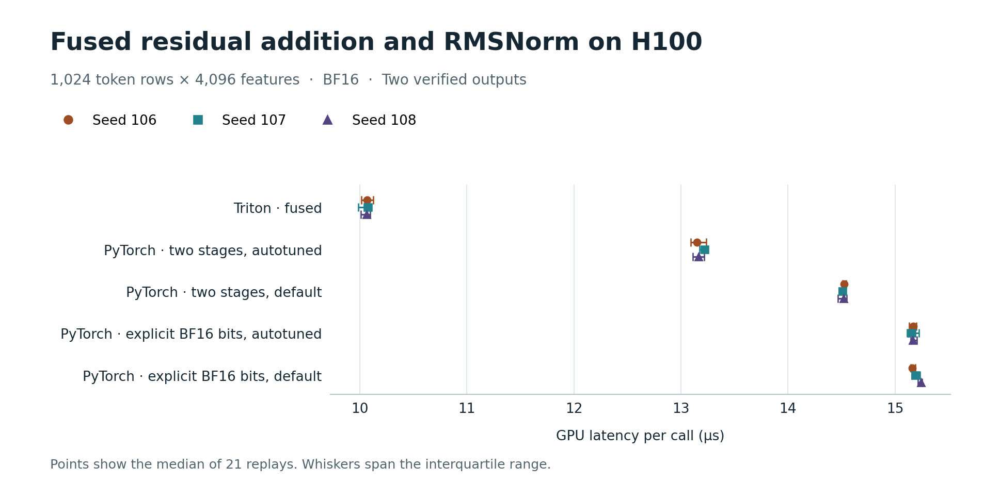

# Precision-matched residual RMSNorm on H100

**Fused Triton reduced operator latency by 23.44–23.83% against the fastest correct compiled PyTorch implementation.** Each of three independent seeds at 1,024 rows by 4,096 features passed the registered 5% criterion. Both implementations returned the updated BF16 residual and its normalization. [Registered plan](PLAN.md) · [PR #10](https://github.com/hyscodebase/h100-rmsnorm-lab/pull/10)

| Seed | Triton µs | Best compiled µs | Latency reduction | Correct compiled modes timed |
| ---: | ---: | ---: | ---: | ---: |
| [106](results/tasks/s106-r1024-w4096.json) | 10.068 | 13.150 | 23.44% | 4 |
| [107](results/tasks/s107-r1024-w4096.json) | 10.072 | 13.223 | 23.83% | 4 |
| [108](results/tasks/s108-r1024-w4096.json) | 10.062 | 13.164 | 23.56% | 4 |

Two separately compiled stages using `max-autotune-no-cudagraphs` formed the fastest correct reference in all three seeds. The two compiled modes that encode rounding inside one graph measured 15.156–15.242 µs. Eager PyTorch measured 116.215–116.498 µs. All numbers are medians of 21 CUDA-graph samples with 32 invocations per graph and both outputs retained. Reported latency applies to this two-output operator, input shape, and H100 software stack. [Raw timings and checks](results/tasks)



## Why the comparison qualifies

- The old explicit and native compiled expressions failed the BF16 denominator tie in both modes during seed 105. The split reference materializes the intermediate BF16 tensor between separately compiled stages. The single-graph reference encodes its BF16 rounding in integer operations and reconstructs the FP32 operands from those bits. Both new references passed in both compile modes. [Numerical preflight](results/tasks/s105-r1024-w4096.json) · [Implementations](baselines.py)
- The exact rounding test covers positive and negative midpoint neighbors, even and odd ties, a mantissa carry, and both zero encodings. The two new references, eager PyTorch, and Triton passed the six original fixtures and the signed-zero operator check. Each timed checkpoint also verified both outputs of each of the 32 captured calls independently against FP64 before measuring. Together the timing runs verified 576 output pairs. [Execution code](campaign.py)
- Six eligible backends used the same shape, seeded input addresses and shuffle protocol for each of three timing checkpoints. Timed replays recorded 378 raw CUDA-event intervals. The 0.372 seconds covered by those intervals represent a short latency experiment. The 65.017 controller seconds across all four attempts include network transfer, compilation, correctness, warmup and cleanup. [Attempts and execution durations](results/attempts)

## Reproduce the decision

Measured on NVIDIA H100 80GB HBM3, CUDA 12.8, driver 550.144.03, PyTorch 2.7.1+cu128 and Triton 3.3.1. The preflight fixes the four eligible compiled modes and both controls for the timing seeds. The report checks all eight source blob hashes at the same recorded Git commit, backend eligibility and raw sample arithmetic. [Source revision](https://github.com/hyscodebase/h100-rmsnorm-lab/commit/f190f525b86150e6971047bb5c446d0048aa75e4) · [Manifest](results/manifest.json)

```bash
python3 experiments/rmsnorm-residual/materialized/report.py
python3 experiments/rmsnorm-residual/materialized/plot_results.py
```
