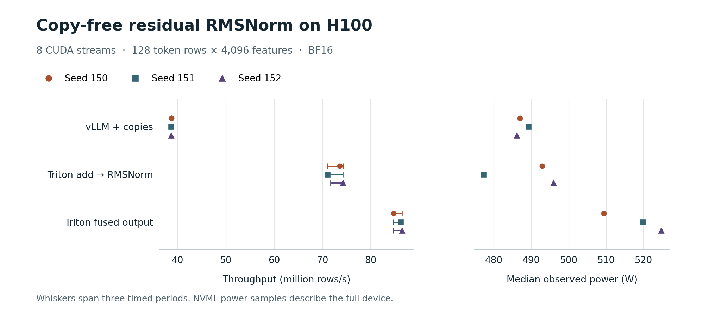

# Copy-free residual RMSNorm fusion on H100

At 128 × 4,096 with eight CUDA streams, the fused kernel delivered **15.12–21.43% more throughput** than a vectorized two-kernel implementation. Both implementations preserve the BF16 activation, residual and weight and write the two outputs to the same addresses. The fused path cleared the registered 5% gain in all three timing seeds. This comparison tests fusion with restoration copies absent from both graphs. [Registered protocol](COPY_FREE_FUSION.md) · [Frozen source](https://github.com/hyscodebase/h100-rmsnorm-lab/commit/be04c0880e53922869bbc43437e5b46450407d77)

## Throughput

| Seed | vLLM + restoration | Copy-free add → RMSNorm | Fused direct output | Fusion gain over two kernels |
| ---: | ---: | ---: | ---: | ---: |
| 150 | 38.664 | 73.571 | 84.698 | +15.125% |
| 151 | 38.657 | 70.993 | 86.206 | +21.429% |
| 152 | 38.654 | 74.199 | 86.477 | +16.547% |

Rates are median wall throughput in millions of normalized rows per second across three balanced periods per backend in each seed. Each graph uses 32 disjoint input pairs and each burst enqueues 32 replays per stream. The released vLLM operator restores both inputs into the writable outputs before applying its in-place kernel. Fusion delivered 2.191–2.237 times that reference's throughput. The rates cover repeated synthetic CUDA Graph inputs at the tested shape. [Raw timing and completed graph counts](copy-free-results)



The first copy-free baseline kernel uses four warps per 2,048-element tile. Its PTX contains four 128-bit global load and two 128-bit global store instructions. Its second kernel reads the rounded BF16 residual and applies the same 16-warp FP32 reduction, CTA barrier and BF16 round before weight multiplication as the fused kernel. Fusion removes the second kernel dispatch and the logical reread of one 1 MiB residual tensor per pair. All three compiled kernels had zero reported spills. The fused binary matched the preceding campaign and all binary identities remained fixed after qualification. [Addition and launch code](two_kernel.py) · [Compiler and exactness checkpoint](copy-free-results/s149.json)

The four seeds checked eight numerical fixtures each, including signed zero and the BF16 weight-rounding probe. After poisoning the output buffers, the two copy-free implementations matched the reference across 2,147,483,648 output-element comparisons over the four captured workloads. Both copy-free launchers rejected all three tested output aliases. The original activation, original residual and weight hashes matched after each backend's verification replay and again after timing. Both outputs matched the reference after every timed period. [Numerical checkpoints](copy-free-results)

## H100 use and coverage

The 27 measured periods took **162.268 seconds** and processed 10,659,823,616 normalized rows. The archive retains 10,166 timed and 1,694 warm-up CUDA-event intervals. The 155 in-window NVML GPU activity samples gave a 100% median in all nine backend-seed groups.

| Backend | Activity samples per seed | Median GPU activity | Seed median power range | Peak power |
| --- | ---: | ---: | ---: | ---: |
| vLLM + restoration | 18–19 | 100% | 486.1–489.2 W | 492.2 W |
| Copy-free add → RMSNorm | 15–18 | 100% | 477.2–495.9 W | 501.1 W |
| Fused direct output | 16–19 | 100% | 509.3–524.7 W | 527.9 W |

Seven groups met the direct NVML coverage and sustained activity criteria. The two other groups were the split implementation in seeds 151 and 152, where the largest observation gap reached 2.242 seconds. The highest in-window device memory and temperature readings were 3,057.25 MiB and 46 °C. The SSH observer recorded another 289 device samples across the four local attempt windows. Both observers collect whole-device metrics. [Supplemental device samples](copy-free-results/device-samples.json)

The original UTC fields show the H100's seed-152 finish time 0.632 seconds after the local checkpoint save. Three post-run timestamp exchanges put the H100 clock 2.019–2.061 seconds ahead at the time of the probes. That offset range fits all four attempt windows. Rates and direct NVML block membership use the H100's monotonic clock. The cache-only check of seed 150 matched the original checkpoint by canonical JSON SHA-256. [Clock exchanges](copy-free-results/clock-probe.json) · [Cache-only recovery](copy-free-results/checkpoint-recovery.json)

## Reproduce

```bash
python3 experiments/rmsnorm-residual/vllm/copy_free_report.py
python3 experiments/rmsnorm-residual/vllm/copy_free_plot.py
```

The verifier recomputes the throughput and NVML windows from the original intervals and samples. It checks numerical evidence, frozen source and binaries, attempt records and recovery. To rerun seed 149, use the same H100 stack and pinned vLLM extension. For a timing seed, also supply the matching seed-149 result with `--qualified`. [Released extension setup](REPORT.md#reproduce-the-numerical-checkpoint)

```bash
BENCH_REVISION=be04c0880e53922869bbc43437e5b46450407d77 \
  python3 experiments/rmsnorm-residual/vllm/copy_free_run.py \
    --seed 149 --asset-dir .lab/vllm-release
```

The next run tests the same kernels at 255 rows within vLLM's below-256 dispatch regime. [255-row protocol](COPY_FREE_ROWS_255.md)
