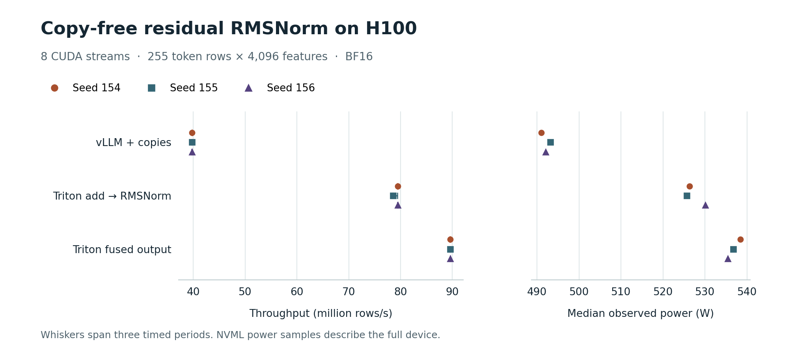

# Copy-free residual RMSNorm at 255 rows

The fused direct-output kernel delivered **12.77–14.03% more throughput** than the matched copy-free addition and normalization kernels at 255 × 4,096. All three independent timing seeds cleared the registered 5% threshold with bitwise matching BF16 outputs. The H100 ran the same three Triton binaries, vLLM extension and eight-stream timing protocol as the 128-row comparison. [Protocol](COPY_FREE_ROWS_255.md) · [128-row result](COPY_FREE_FUSION_REPORT.md) · [Frozen source](https://github.com/hyscodebase/h100-rmsnorm-lab/commit/3943d33dca6e7b514a1c3963718b3b8850800c56)

## Throughput

| Seed | vLLM + restoration | Copy-free add → RMSNorm | Fused direct output | Fusion gain over two kernels |
| ---: | ---: | ---: | ---: | ---: |
| 154 | 39.769 | 79.471 | 89.616 | +12.766% |
| 155 | 39.742 | 78.584 | 89.607 | +14.026% |
| 156 | 39.741 | 79.433 | 89.607 | +12.809% |

Each rate is the median of three measured periods in millions of normalized rows per second. Each graph processes 32 input pairs per stream. The two copy-free, immutable-input implementations write directly to the same output addresses. The vLLM graph restores its two in-place inputs with 127.5 MiB of explicit copy payload per stream replay. The maximum simultaneous input, weight and output buffer footprint for the measured graphs was about 1.99 GiB. [Raw checkpoints](copy-free-255-results)



The gain over the copy-free two-kernel graph was 15.12–21.43% at 128 rows and 12.77–14.03% at 255 rows. The comparison supports fused direct output at both tested shapes. It covers repeated synthetic CUDA Graph workloads with fixed hidden width 4,096 and eight streams.

## Exactness and provenance

The four seeds each checked eight fixtures including signed zero and BF16 weight rounding. Both direct-output launchers rejected all three tested buffer aliases. After poisoning the writable buffers, the copy-free paths matched 4,278,190,080 reference output elements across four captured workloads. Both outputs matched after every timed period. Source and weight hashes matched after each backend's verification replay and after timing.

The verifier compares canonical PTX and cubin SHA-256 values to the 128-row accuracy checkpoint for the four-warp addition, split normalization and fused kernel. It checks the full source manifest at the frozen commit and recomputes completed rows, per-seed throughput and NVML coverage. A cache-only retrieval of seed 154 matched the original checkpoint's canonical JSON. [Accuracy and compiled binaries](copy-free-255-results/s153.json) · [Recovery proof](copy-free-255-results/checkpoint-recovery.json)

## H100 use and coverage

The 27 measured periods took **162.572 seconds**, processed 11,297,095,680 normalized rows, and produced 5,408 timed and 914 warm-up CUDA-event intervals. Direct NVML returned 153 in-window GPU activity samples with a 100% median in all nine backend-seed groups. Six groups met the sustained activity and coverage criteria. The largest gap was 2.575 seconds.

| Backend | In-window activity samples per seed | Median GPU activity | Seed median power range | Peak power |
| --- | ---: | ---: | ---: | ---: |
| vLLM + restoration | 15–18 | 100% | 491.0–493.2 W | 494.7 W |
| Copy-free add → RMSNorm | 13–18 | 100% | 525.6–530.1 W | 536.0 W |
| Fused direct output | 18 | 100% | 535.4–538.4 W | 540.4 W |

The highest in-window device readings were 4,849.25 MiB of VRAM and 45 °C. Each timed checkpoint recorded a 3,359.90 MiB peak allocation in PyTorch. The supplemental SSH observer retained 218 samples across four attempt windows. Three SSH timestamp exchanges reconcile the two systems' UTC logs. Timed intervals and direct NVML assignments use the H100 host's monotonic clock. [Supplemental samples](copy-free-255-results/device-samples.json) · [Clock exchanges](copy-free-255-results/clock-probe.json)

## Reproduce

```bash
python3 experiments/rmsnorm-residual/vllm/copy_free_report.py --rows 255
python3 experiments/rmsnorm-residual/vllm/copy_free_plot.py --rows 255
```

To rerun seed 153, use the same recorded H100 stack and pinned vLLM extension. For a timing seed, also supply the matching seed-153 result with `--qualified`. [Released extension setup](REPORT.md#reproduce-the-numerical-checkpoint)

```bash
BENCH_REVISION=3943d33dca6e7b514a1c3963718b3b8850800c56 \
  python3 experiments/rmsnorm-residual/vllm/copy_free_run.py \
    --rows 255 --seed 153 --asset-dir .lab/vllm-release
```

The next campaign crosses vLLM's 256-row dispatch change and tests a copy-free pair that follows its eight-warp FP32 reduction. [256-row plan](COPY_FREE_ROWS_256.md) · [Tracking issue](https://github.com/hyscodebase/h100-rmsnorm-lab/issues/32)
