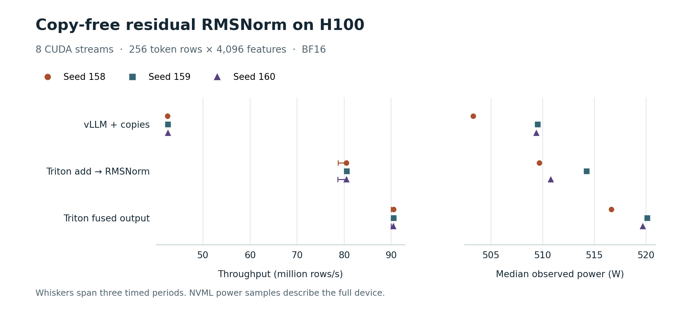

# Copy-free residual RMSNorm at the 256-row vLLM boundary

With the eight-warp FP32 reduction, the fused kernel matched both BF16 outputs and delivered **12.38–12.48% more throughput** than the matched copy-free two-kernel graph at 256 × 4,096. It cleared the registered 5% gain in all three independent timing seeds.

## Exactness at the dispatch boundary

At 256 × 4,096, released vLLM 0.10.0 changes to 256 threads per block. Each lane sums both eight-element groups before the warp reduction. The fused and split copy-free kernels reuse that ordered FP32 reduction and the same BF16 rounding before weight multiplication. Both write the normalized activation and rounded residual to disjoint output buffers. [Registered experiment](COPY_FREE_ROWS_256.md) · [vLLM dispatch](https://github.com/vllm-project/vllm/blob/v0.10.0/csrc/layernorm_kernels.cu#L161-L199) · [Frozen source](https://github.com/hyscodebase/h100-rmsnorm-lab/commit/c49e157150b60a04139f7fc269ae05c66f971916)

The unchanged 16-warp binary from the 255-row campaign differed from vLLM on **1,161 of 268,435,456** captured activation values in seed 157. The differences appeared in 38 of the 256 pairs across all eight streams. All stored residuals and input hashes agreed. In the fixture with zero rows, 22 activation values differed and 18 failed the bounded numerical check. The eight-warp implementations matched every activation and residual bit on the same captured inputs. [Diagnostic and exactness checkpoint](copy-free-256-results/s157.json)

Both eight-warp kernels emitted 128-bit global loads and stores, five warp shuffles at offsets 1, 2, 4, 8 and 16, two vector shared loads and one CTA barrier. Each used 32 registers per thread with zero spills. The four-warp addition retained the canonical PTX and cubin hashes from the 255-row comparison. [Eight-warp source](eight_warp_outputs.py) · [Preceding experiment](COPY_FREE_ROWS_255_REPORT.md)

## Throughput

| Seed | vLLM + restoration | Copy-free add → RMSNorm | Fused direct output | Fusion gain over two kernels |
| ---: | ---: | ---: | ---: | ---: |
| 158 | 42.457 | 80.466 | 90.512 | +12.485% |
| 159 | 42.562 | 80.517 | 90.512 | +12.414% |
| 160 | 42.561 | 80.469 | 90.432 | +12.381% |

Rates are median wall throughput in millions of normalized rows per second across three balanced periods per backend and seed. Each of eight streams processes 32 input pairs per graph replay. Both measured Triton paths use the same immutable inputs and disjoint writable outputs. Released vLLM restores 128 MiB of input payload per stream replay. The figure covers repeated synthetic CUDA Graph inputs. [Raw timings and code-generation metadata](copy-free-256-results)



The two copy-free paths matched 4,294,967,296 reference output elements across four captured workloads, with zero bit differences. Both matched the reference after every timed period. The eight numerical fixtures, rejected alias probes and unchanged source and weight hashes are stored by seed. [Numerical records](copy-free-256-results)

## H100 use and coverage

The 27 measured periods took **162.361 seconds** and completed 11,525,947,392 normalized rows. The archive contains 5,496 timed and 931 warm-up CUDA-event intervals. Direct NVML collected 150 in-window activity samples. All nine groups had a 100% median, and seven met the sustained activity and coverage criteria. The two groups with larger gaps were vLLM in seed 158 and the split kernel in seed 160. The longest gap was 3.255 seconds.

| Backend | In-window activity samples per seed | Median GPU activity | Seed median power range | Peak power |
| --- | ---: | ---: | ---: | ---: |
| vLLM + restoration | 14–18 | 100% | 503.3–509.5 W | 512.6 W |
| Copy-free add → RMSNorm | 14–18 | 100% | 509.6–514.2 W | 515.5 W |
| Fused direct output | 17 | 100% | 516.6–520.1 W | 521.3 W |

The highest in-window readings were 4,849.25 MiB of VRAM and 44 °C. The SSH observer retained 229 additional samples across the four attempt windows. The audit uses monotonic H100 intervals to recompute timings and direct NVML assignments, and three clock exchanges to check the two hosts' UTC records. Seed 158 matched a cache-only retrieval by canonical JSON SHA-256. [Supplemental device samples](copy-free-256-results/device-samples.json) · [Clock exchanges](copy-free-256-results/clock-probe.json) · [Recovery proof](copy-free-256-results/checkpoint-recovery.json)

## Reproduce

```bash
python3 experiments/rmsnorm-residual/vllm/copy_free_report.py --rows 256
python3 experiments/rmsnorm-residual/vllm/copy_free_plot.py --rows 256
```

Supply the recorded H100 stack and pinned vLLM extension to rerun the exactness checkpoint. For a timing seed, also supply the matching seed-157 record with `--qualified`. [Released extension setup](REPORT.md#reproduce-the-numerical-checkpoint)

```bash
BENCH_REVISION=c49e157150b60a04139f7fc269ae05c66f971916 \
  python3 experiments/rmsnorm-residual/vllm/copy_free_run.py \
    --rows 256 --seed 157 --asset-dir .lab/vllm-release
```

The next experiment keeps the exact eight-warp binaries and tests 512 rows, which doubles the live buffer footprint. [512-row plan](COPY_FREE_ROWS_512.md) · [Tracking issue](https://github.com/hyscodebase/h100-rmsnorm-lab/issues/34)
