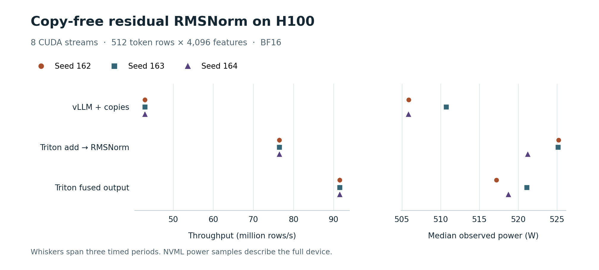

# Binary-matched copy-free residual RMSNorm at 512 rows

The fused graph produced **19.74–19.76% more throughput** than the matched copy-free two-kernel path at 512 × 4,096. Each of the three independent timing seeds cleared the registered 5% threshold and matched both BF16 outputs. The three kernel binaries and eight-stream protocol matched those used at 256 rows.

## Workload and numerical checks

The H100 runs the same three Triton binaries that qualified at 256 rows. The two copy-free paths use identical BF16 input and output addresses, the same ordered eight-warp reduction and the same BF16 rounding. Raising the row count to 512 brings the disjoint live buffer footprint to about 4 GiB. vLLM 0.10.0 with two input restoration copies supplies the reference. [Registered experiment](COPY_FREE_ROWS_512.md) · [256-row result](COPY_FREE_ROWS_256_REPORT.md) · [Frozen source](https://github.com/hyscodebase/h100-rmsnorm-lab/commit/faf7848ffad77540b7da8f5d75695718f94d3422)

Each numerical check covers eight fixtures, including signed zero and BF16 weight rounding, plus 256 independently generated captured pairs in that seed. The verifier checks poisoned writable buffers, rejected output aliases, and unchanged source and weight hashes. It verifies the canonical PTX and cubin hashes of the four-warp addition, the eight-warp split normalization and the eight-warp fused kernel against seed 157. [Numerical and compiler evidence](copy-free-512-results/s161.json)

The split graph reads the stored BF16 residual once more after the addition. At 512 × 4,096, that logical read is 4 MiB per input pair. Excluding the shared weight tensor, the fused path reads or writes 8 logical bytes per element and the split path reads or writes 10. Measuring where those requests are served requires memory-hierarchy counters. [Kernel code](eight_warp_outputs.py) · [NVIDIA memory-counter definitions](https://docs.nvidia.com/nsight-compute/ProfilingGuide/index.html#device-memory)

## Throughput

| Seed | vLLM + restoration | Copy-free add → RMSNorm | Fused direct output | Fusion gain over two kernels |
| ---: | ---: | ---: | ---: | ---: |
| 162 | 42.879 | 76.445 | 91.550 | +19.759% |
| 163 | 42.874 | 76.440 | 91.534 | +19.747% |
| 164 | 42.875 | 76.445 | 91.536 | +19.741% |

Rates are median wall throughput in millions of normalized rows per second across three balanced periods per backend and seed. Each graph processes 32 synthetic input pairs per stream. The vLLM reference restores 256 MiB of explicit input payload per stream replay. On the tested workload the fused rate rose from 90.432–90.512 million rows per second at 256 rows to 91.534–91.550 at 512, and the split rate fell from 80.466–80.517 to 76.440–76.445. [Raw timing and graph counts](copy-free-512-results) · [256-row comparison](COPY_FREE_ROWS_256_REPORT.md)



The two copy-free paths matched 8,589,934,592 reference output elements across the four captured workloads. All three timing seeds retained both exact outputs after every measured period and preserved the original activation, residual and weight hashes. [Numerical records](copy-free-512-results)

## H100 use and coverage

The 27 measured periods took **162.947 seconds** and processed 11,437,867,008 normalized rows. The archive preserves 2,727 timed and 468 warm-up CUDA-event intervals. Direct NVML returned 152 in-window GPU activity samples. Usage reached a 100% median in all nine backend-seed groups. Six groups met the coverage and sustained activity criteria. The largest gap was 3.434 seconds. [Direct NVML records](copy-free-512-results)

| Backend | In-window activity samples per seed | Median GPU activity | Seed median power range | Peak power |
| --- | ---: | ---: | ---: | ---: |
| vLLM + restoration | 15–18 | 100% | 505.8–510.7 W | 511.6 W |
| Copy-free add → RMSNorm | 16–18 | 100% | 521.2–525.2 W | 527.7 W |
| Fused direct output | 17–18 | 100% | 517.2–521.1 W | 523.3 W |

The highest in-window readings were 8,433.25 MiB of VRAM and 45 °C. PyTorch recorded a peak allocation of 6,720.02 MiB in every checkpoint. The supplemental SSH observer kept 280 samples over the four local attempt windows. The audit verifies the two hosts' UTC records using three clock exchanges. The H100's monotonic clock determines wall intervals and direct NVML sample membership. Cache-only retrieval of seed 162 matched the saved checkpoint's canonical JSON. [Supplemental device samples](copy-free-512-results/device-samples.json) · [Clock exchanges](copy-free-512-results/clock-probe.json) · [Recovery proof](copy-free-512-results/checkpoint-recovery.json)

## Reproduce

```bash
python3 experiments/rmsnorm-residual/vllm/copy_free_report.py --rows 512
python3 experiments/rmsnorm-residual/vllm/copy_free_plot.py --rows 512
```

Supply the recorded H100 stack and pinned vLLM extension to rerun the numerical checkpoint. For timing, supply the matching seed-161 JSON with `--qualified`. [Released extension setup](REPORT.md#reproduce-the-numerical-checkpoint)

```bash
BENCH_REVISION=faf7848ffad77540b7da8f5d75695718f94d3422 \
  python3 experiments/rmsnorm-residual/vllm/copy_free_run.py \
    --rows 512 --seed 161 --asset-dir .lab/vllm-release
```

The next experiment keeps 512 rows and directly measures DRAM reads and writes and L2 read sectors for both graphs. The SHA-verified Nsight Compute CLI is installed in the H100 experiment cache and lists the requested counters. [Memory traffic plan](COPY_FREE_MEMORY_512.md) · [Tracking issue](https://github.com/hyscodebase/h100-rmsnorm-lab/issues/36)
