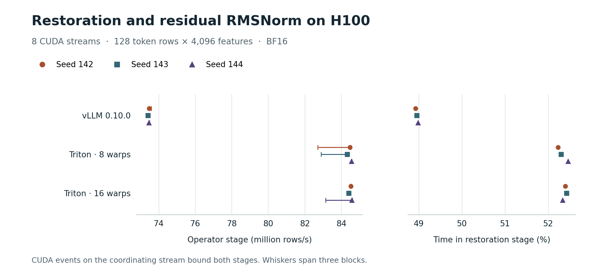

# Separate input restoration and residual RMSNorm on H100

This experiment holds the 128 × 4,096 BF16 shape, eight streams, buffers, three kernels and vLLM release fixed. Each combined replay runs two device copies and 32 in-place calls per stream in a single CUDA Graph. The split replay uses a copy graph and an operator graph on each stream. Timing events on a coordinating stream wait for all eight streams at both stage boundaries. Both stages are enqueued before the host waits for completion. [Registered schedule and criterion](SUSTAINED_COPY_SPLIT.md) · [Frozen source](https://github.com/hyscodebase/h100-rmsnorm-lab/commit/c8f6118) · [PR #25](https://github.com/hyscodebase/h100-rmsnorm-lab/pull/25)

## Operator stage and end-to-end throughput

| Seed | vLLM operator | 8-warp operator | 16-warp operator | 16 warps vs vLLM | 16 vs 8 warps |
| ---: | ---: | ---: | ---: | ---: | ---: |
| 142 | 73.466 | 84.469 | 84.510 | +15.033% | +0.048% |
| 143 | 73.412 | 84.317 | 84.405 | +14.975% | +0.103% |
| 144 | 73.459 | 84.554 | 84.557 | +15.107% | +0.003% |

Rates are millions of normalized rows per second and each entry is a median across three blocks. The registered requirement was at least 5% higher operator-stage throughput against 8 warps in every independent seed. The improvement was below 0.11% in every seed. Restoring the input buffers accounted for 48.93–48.98% of the coordinated split CUDA interval for vLLM, 52.23–52.46% for 8 warps and 52.33–52.42% for 16 warps. Each observation copies 512 MiB of input payload across eight streams.

| Backend | Combined wall rate | Split wall rate |
| --- | ---: | ---: |
| vLLM | 37.225–37.315 | 36.703–36.829 |
| Triton 8 warps | 39.873–39.965 | 39.252–39.404 |
| Triton 16 warps | 39.945–40.027 | 39.272–39.411 |

The wall rates cover the original enqueue and synchronization window. The 16-warp wall rate led vLLM by 7.267–7.308% in the combined schedule and 6.943–7.010% in the split schedule. The small Triton difference remains after separating restoration. The next workload preserves both sources and tests writing the two outputs directly. [Input-preserving kernel plan](SUSTAINED_OUT_OF_PLACE.md)



The workload gives each stream 32 disjoint input pairs. Each seed checks the eight numerical fixtures, including the BF16 rounding probes, before replaying either graph schedule. It verifies restored inputs and both graph outputs, then rechecks both outputs after every measured block. The separately measured operator interval includes the ordering dependencies and outstanding work on all eight streams. [PyTorch CUDA event API](https://docs.pytorch.org/docs/2.7/generated/torch.cuda.Event.html) · [PyTorch graph replay source](https://raw.githubusercontent.com/pytorch/pytorch/v2.7.1/aten/src/ATen/cuda/CUDAGraph.cpp)

## GPU observation and original evidence

The 54 measurement blocks ran for 216.022 seconds and normalized 8,367,800,320 rows including repeated inputs. The archive retains 255,365 measured event observations and 63,854 warm-up observations. Direct NVML contributed 206 in-window readings. GPU activity medians were 97–98% across conditions, with a largest sample gap of 2.276 seconds. In-window readings peaked at 477.8 W, 44 °C and 3,067.25 MiB of device memory. The SSH-based observer retained another 298 device samples across four attempts. [Supporting observer records](copy-split-results/device-samples.json)

The immutable files retain every coordinated CUDA interval, completed pair count, input fingerprint, attempt, and NVML sample. The compressed JSON retains the original checkpoint bytes. The cache-only retrieval matched the original seed-142 canonical JSON hash. [Raw checkpoints](copy-split-results) · [Recovery check](copy-split-results/checkpoint-recovery.json)

## Reproduce

```bash
python3 experiments/rmsnorm-residual/vllm/copy_split_report.py
python3 experiments/rmsnorm-residual/vllm/copy_split_plot.py
gzip -dc experiments/rmsnorm-residual/vllm/copy-split-results/s142.json.gz
```

The verifier checks frozen source hashes, candidate binaries, the extension identity, numerical gates, stage boundaries, device sums, NVML sample assignment and per-seed throughput. To reproduce a GPU checkpoint, prepare the recorded H100 stack and vLLM wheel. A timing seed uses the saved qualification from the same revision. [vLLM extension setup](REPORT.md#reproduce-the-numerical-checkpoint)

```bash
BENCH_REVISION=c8f6118b5313882fb1d8cfe8b99238afbb6c5db6 \
  python3 experiments/rmsnorm-residual/vllm/copy_split_run.py \
    --seed 141 --asset-dir .lab/vllm-release
```
