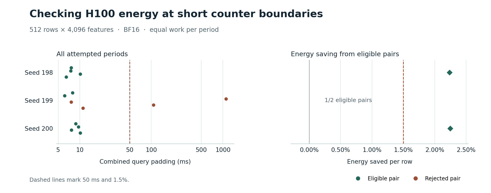

# Equal-work H100 energy comparison with short counter boundaries

The two independent seeds with both eligible orders showed **2.237–2.244% less energy per row** for four warps and **0.026–0.029% lower throughput**. Seed 199 supplied only one eligible pair after the one permitted repeat. The experiment therefore has two complete exact comparisons toward the three-seed acceptance criterion. [Raw checkpoints](energy-counter-boundaries-512-results)

## Controlled workload

Both frozen residual RMSNorm kernels operate at 512 × 4,096 BF16 on eight CUDA streams. Each stream captures 32 disjoint pairs. Each measured period begins after at least three seconds of warm-up and runs exactly 512 bursts for 2,147,483,648 normalized rows. The verifier checks both timed binary identities, all input and weight hashes and both output tensors. [Registered protocol](COPY_FREE_ENERGY_COUNTER_BOUNDARIES_512.md) · [Earlier cumulative-counter result](FOUR_WARP_ENERGY_512_REPORT.md)

One process serializes NVML reads. Auxiliary device snapshots occur before warm-up and after the closing energy query. The two queries that bracket fixed work record their raw millijoules, status and monotonic start and end timestamps. The sum of the two boundary delays must be no more than 50 ms in both windows of a pair. Each seed needs two eligible pairs in opposite orders. The first rejected pair can be repeated once in the same order, with every original window retained. [Assigned-device NVML API](https://docs.nvidia.com/deploy/archive/R550/nvml-api/group__nvmlDeviceQueries.html)

Seed 197 passed all eight numerical fixtures, exact capture checks and binary identities. The counter advanced by 703,112 mJ in the active probe, with 14.588 ms of boundary padding. The complete checkpoint was pushed before seed 198 began. [Qualification commit](https://github.com/hyscodebase/h100-rmsnorm-lab/commit/d6ef1ee3b9ff70746a58fb0fbc8fb9de4481f725) · [Raw qualification](energy-counter-boundaries-512-results/s197.json)

## Independent H100 measurements

| Seed | Eligible / attempted pairs | Maximum attempted padding (ms) | Eight warps (J/billion rows) | Four warps (J/billion rows) | Energy saved | Throughput change |
| ---: | :---: | ---: | ---: | ---: | ---: | ---: |
| 198 | 2 / 2 | 10.158 | 5,746.35 | 5,617.81 | 2.2369% | −0.0260% |
| 199 | 1 / 3 | 1,104.210 | — | — | Incomplete | — |
| 200 | 2 / 2 | 10.136 | 5,719.96 | 5,591.58 | 2.2444% | −0.0290% |

Both BF16 outputs and the source hashes agreed in all three seeds, including every attempted period in seed 199. The two complete seeds met both the 1.5% energy and 0.5% throughput criteria. All periods in eligible pairs had at most 10.158 ms of combined boundary padding. The result preserves the incomplete seed and its original and repeated windows. [Full per-period records](energy-counter-boundaries-512-results)



## Where the remaining delay occurred

In seed 199, the opening counter call in the four-warp-first pair lasted 1.098 seconds. Its closing call took 5.678 ms. In the one repeat, the opening call took 3.791 ms and the closing call took 102.950 ms. The combined time outside the two calls was at most 0.223 ms in those two periods. This isolates the observed delay to the query intervals and motivates measuring the timestamp attached to the returned energy sample. [Seed 199 queries and retries](energy-counter-boundaries-512-results/s199.json)

## H100 resource observations

The seven attempted pairs ran **328.55 seconds** of fixed work, with 42.35 seconds of recorded warm-up, and completed 30,064,771,072 normalized rows including repeats. Five eligible pairs account for 234.67 seconds and 21,474,836,480 rows. The eligible total includes the one usable pair from seed 199. The 28 auxiliary snapshots cover the points before warm-up and after the final counter query. In the 14 post-window samples, device activity had a median of 100% and observed maxima of 527.305 W, 46 °C and 8,431.25 MiB of GPU memory. These snapshots describe their stated scope. [Counter and auxiliary data](energy-counter-boundaries-512-results)

The archive retains all four attempt windows and both SSH time probes. Seed 198 was recovered from the cache with an identical canonical result digest. [Recovery](energy-counter-boundaries-512-results/checkpoint-recovery.json) · [Before probe](energy-counter-boundaries-512-results/clock-probe-before.json) · [After probe](energy-counter-boundaries-512-results/clock-probe.json)

## Next experiment

Qualify the cumulative energy field reported by NVML with its own CPU sample timestamp. Check coverage around actual work using the reported timestamp and a wall-to-monotonic clock mapping. Retain both API call boundaries and sample times to diagnose stale or delayed readings. [Follow-up protocol](COPY_FREE_TIMESTAMPED_NVML_ENERGY_512.md) · [Tracking issue](https://github.com/hyscodebase/h100-rmsnorm-lab/issues/54)

## Reproduce

Use the recorded H100 and frozen source revision `a7b037c008870a542224856007fc04e1fe2aee3a`, with the same CUDA, PyTorch, Triton and released vLLM stack. The runner records device samples at the designated points around each period. [vLLM extension setup](REPORT.md#reproduce-the-numerical-checkpoint)

```bash
BENCH_REVISION=a7b037c008870a542224856007fc04e1fe2aee3a \
  python3 experiments/rmsnorm-residual/vllm/energy_counter_boundaries_run.py \
    --seed 197 --asset-dir .lab/vllm-release

BENCH_REVISION=a7b037c008870a542224856007fc04e1fe2aee3a \
  python3 experiments/rmsnorm-residual/vllm/energy_counter_boundaries_run.py \
    --seed 198 --asset-dir .lab/vllm-release \
    --qualified experiments/rmsnorm-residual/vllm/energy-counter-boundaries-512-results/s197.json
```

```bash
python3 experiments/rmsnorm-residual/vllm/energy_counter_boundaries_report.py
python3 experiments/rmsnorm-residual/vllm/energy_counter_boundaries_plot.py
```
