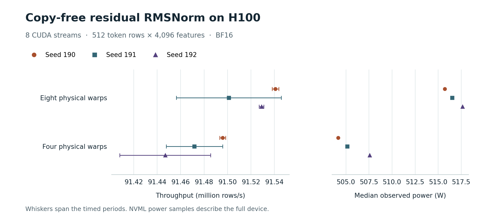

# Four physical warps with the same ordered 512-row reduction

The four-warp fused kernel matched the released vLLM outputs bitwise and reached **91.447–91.496 million rows/s**. It was **0.032–0.090% slower** than the frozen eight-warp fused variant in three independent H100 seeds, below the registered 5% throughput criterion. The measured-window board power medians were **10.07–11.56 W lower**. [Timing, exactness and device data](four-physical-warps-512-results)

## Workload and exactness

The isolated comparison uses 512 × 4,096 BF16, eight CUDA streams and 32 disjoint input/output pairs per stream. Both benchmark graphs call one fused residual RMSNorm per pair and write both outputs to the same preallocated addresses. They preserve the BF16 source and weight buffers. Released vLLM provides the numerical oracle. The benchmark pins the original fused eight-warp kernel's cubin and canonical PTX. [Registered protocol](COPY_FREE_FOUR_PHYSICAL_WARPS_512.md) · [Prior 512-row result](COPY_FREE_ROWS_512_REPORT.md)

Physical thread `p` computes ordered partials for logical threads `p` and `p + 128`, using the same two groups of eight BF16 values for each. Two independent FP32 warp shuffle chains write totals into slots `w0` through `w7`. A CTA barrier precedes the shared loads and the original ordered fold. The kernel validates the physical thread mapping and keeps the existing BF16 rounding points. [Kernel](four_physical_warps.py) · [PTX shuffle semantics](https://docs.nvidia.com/cuda/archive/12.8.1/parallel-thread-execution/index.html#data-movement-and-conversion-instructions-shfl-sync) · [Triton inline assembly](https://triton-lang.org/main/python-api/generated/triton.language.inline_asm_elementwise.html)

Seed 189 passed eight fixtures and compared 536,870,912 captured BF16 values per output and implementation with zero differences. Both candidates rejected output aliases and preserved 17 original input and weight digests. The full qualification and compiled evidence were pushed before independent timing. [Qualification commit](https://github.com/hyscodebase/h100-rmsnorm-lab/commit/4205529bf11bc41a616eb98117a5ad9d336202a1) · [Seed 189](four-physical-warps-512-results/s189.json)

## Compiler evidence

| Physical warps | Threads per CTA | Registers per thread | Spills | 128-bit load/store instructions | Warp shuffles | CTA barriers |
| ---: | ---: | ---: | ---: | ---: | ---: | ---: |
| 8 | 256 | 32 | 0 | 6 / 4 | 5 | 1 |
| 4 | 128 | 54 | 0 | 12 / 8 | 10 | 1 |

These are static PTX instruction counts. The two implementations each declare one 32-byte warp-totals array in inline PTX. The recorded instructions and frozen source hashes let the verifier check the two shuffle chains and the ordered shared-memory fold. [Compiled instructions and launch metadata](four-physical-warps-512-results/s189.json)

## Independent H100 measurements

| Seed | Eight warps (million rows/s) | Four warps (million rows/s) | Four-warp throughput change | Eight-warp observed median power (W) | Four-warp observed median power (W) |
| ---: | ---: | ---: | ---: | ---: | ---: |
| 190 | 91.5409 | 91.4959 | −0.0492% | 515.71 | 504.15 |
| 191 | 91.5011 | 91.4718 | −0.0320% | 516.52 | 505.15 |
| 192 | 91.5290 | 91.4468 | −0.0898% | 517.63 | 507.56 |

Each reported throughput is the median of two balanced periods per implementation. Both BF16 outputs matched before timing and after each measured period. The original activation, residual and weight digests matched after timing. The per-seed power values summarize direct NVML samples assigned to measured windows. [Raw checkpoints](four-physical-warps-512-results)



## H100 resource observations

The 12 measured periods totaled **72.06 seconds**, with 12.10 seconds of recorded warm-up. They completed 402,432 CUDA graph replays and 6,593,445,888 rows including repetitions. The 68 direct NVML samples had a median device activity of 100% in all six backend-seed groups. Three groups met the sustained-load coverage criterion. The largest in-window observation gap was 2.465 seconds. The measured-window peaks were **521.337 W**, **42 °C** and **8,431.25 MiB** of occupied GPU memory. The supplemental collector recorded 173 samples across all four attempts. [Supplemental observations](four-physical-warps-512-results/device-samples.json)

Seed 190's cache-only recovery matched the original canonical result digest. The records include all attempt windows and before/after SSH clock probes. [Recovery](four-physical-warps-512-results/checkpoint-recovery.json) · [Before probe](four-physical-warps-512-results/clock-probe-before.json) · [After probe](four-physical-warps-512-results/clock-probe.json)

## Next experiment

The power observations motivate a fixed-work energy comparison on the same H100. Measure board energy around an identical number of completed rows for both frozen kernels. Require a 1.5% reduction in joules per row and at most a 0.5% throughput reduction in every independent exact seed. [Energy experiment protocol](COPY_FREE_FOUR_WARP_ENERGY_512.md) · [Tracking issue](https://github.com/hyscodebase/h100-rmsnorm-lab/issues/50)

## Reproduce

Use the recorded H100 and the pinned CUDA, PyTorch, Triton and vLLM extension stack. The measurement source revision is `9976e4f2f42d37669d8c39702b76a9438b570bf5`. [vLLM extension setup](REPORT.md#reproduce-the-numerical-checkpoint)

```bash
BENCH_REVISION=9976e4f2f42d37669d8c39702b76a9438b570bf5 \
  python3 experiments/rmsnorm-residual/vllm/four_physical_warps_run.py \
    --seed 189 --asset-dir .lab/vllm-release

BENCH_REVISION=9976e4f2f42d37669d8c39702b76a9438b570bf5 \
  python3 experiments/rmsnorm-residual/vllm/four_physical_warps_run.py \
    --seed 190 --asset-dir .lab/vllm-release \
    --qualified experiments/rmsnorm-residual/vllm/four-physical-warps-512-results/s189.json
```

```bash
python3 experiments/rmsnorm-residual/vllm/four_physical_warps_report.py
python3 experiments/rmsnorm-residual/vllm/four_physical_warps_plot.py
```
