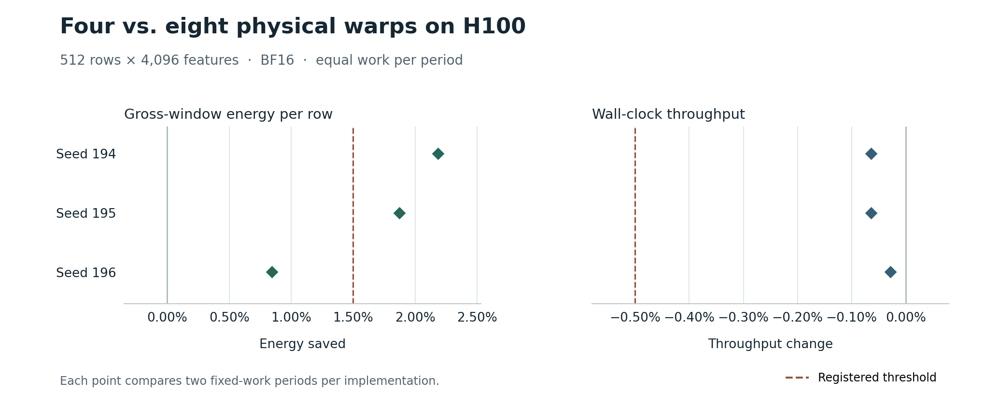

# H100 energy per row for four- and eight-warp residual RMSNorm

The raw cumulative NVML windows showed **0.844–2.183% less energy per row** for four warps and **0.028–0.064% lower throughput** across three independent exact seeds. Two seeds reached the 1.5% energy criterion. Counter calls added up to **2.274 seconds** of boundary padding, so a tighter measurement is needed to establish how much of the difference comes from the completed work. [Raw checkpoints](four-warp-energy-512-results)

## Controlled workload

The same frozen four- and eight-warp fused kernels process 512 × 4,096 BF16 tensors across eight CUDA streams, with 32 disjoint input/output pairs per stream. Each measured period contains exactly 512 bursts of 32 replays per stream. This gives 131,072 graph replays and 2,147,483,648 normalized rows per period. Every period has at least three seconds of warm-up, and every independent seed has two balanced periods per implementation. [Registered protocol](COPY_FREE_FOUR_WARP_ENERGY_512.md) · [Prior kernel and power comparison](FOUR_PHYSICAL_WARPS_512_REPORT.md)

The runner reads the assigned CUDA device's cumulative NVML counter around all synchronized work in each measured period. A raw delta in millijoules is converted to joules and divided by the completed rows. The interval includes the gaps between measured replays. Warm-up and bit comparisons take place outside the counter boundaries. The archive retains query start and end timestamps and reports the direct utilization and power samples separately. [NVML energy counter](https://docs.nvidia.com/deploy/archive/R550/nvml-api/group__nvmlDeviceQueries.html)

Seed 193 passed the eight numerical fixtures, both captured output checks, the frozen binary identities and all original input and weight digests. In the counter probe, both boundary calls succeeded and the recorded energy advanced by 733,090 mJ during 134,217,728 rows of work. The qualification was pushed before independent timing. [Qualification commit](https://github.com/hyscodebase/h100-rmsnorm-lab/commit/2f5f3dc4bd78d132a1a76af38241288737abb826) · [Seed 193](four-warp-energy-512-results/s193.json)

## Independent H100 measurements

| Seed | Eight warps (J/billion rows) | Four warps (J/billion rows) | Gross energy saved | Wall throughput change |
| ---: | ---: | ---: | ---: | ---: |
| 194 | 5,714.29 | 5,589.53 | 2.1834% | −0.0643% |
| 195 | 5,724.13 | 5,616.90 | 1.8733% | −0.0637% |
| 196 | 5,700.60 | 5,652.50 | 0.8437% | −0.0279% |

Both kernels passed all numerical fixtures, preserved the input digests and matched both output tensors after every measured period. Each throughput loss stayed within 0.5%. The registered joint criterion requires every seed to reduce energy by at least 1.5%, so the candidate fell short in this experiment. [Original per-period counters and wall timing](four-warp-energy-512-results)



## Counter boundary sensitivity

The query timestamps bound how far the counter interval can extend outside the completed-work window. The total time from the first query start to the first work start plus the time from the last work end to the last query end exceeded 50 ms in six of 12 periods. The maximum was 2.274 seconds in a four-warp period in seed 194. Seed 195 had delayed boundaries on both eight-warp periods. Seed 196 had delayed boundaries in both paths.

The sensitivity calculation uses an illustrative 100 W for the entire padding of one implementation and zero padding energy for the other. Subtracting that possible extra energy from each implementation in turn moves the observed saving through these conditional ranges.

| Seed | Largest boundary padding (s) | Energy saving under the 100 W scenario |
| ---: | ---: | ---: |
| 194 | 2.274 | 2.176–3.118% |
| 195 | 1.013 | 1.350–1.880% |
| 196 | 1.560 | 0.202–1.528% |

The 100 W scenario crosses the 1.5% threshold in seeds 195 and 196. The next comparison will use short counter boundaries before evaluating the same acceptance criterion. [Sensitivity calculation](four_warp_energy_report.py) · [Follow-up protocol](COPY_FREE_ENERGY_COUNTER_BOUNDARIES_512.md)

## H100 resource observations

The 12 fixed-work periods ran for **281.64 seconds**, with 36.30 seconds of recorded warm-up. They executed 1,572,864 graph replays and 25,769,803,776 rows including repetitions. The cumulative counter deltas summed to 146.02 kJ across the 12 gross windows. The 273 in-window NVML samples showed 100% median GPU activity in all six backend-seed groups. Two groups met the sustained-load coverage criterion. The largest sample gap was 3.502 seconds. The observed peaks were **524.888 W**, **45 °C** and **8,431.25 MiB** of occupied GPU memory. The supplemental collector recorded 390 observations across the four attempts. [Supplemental observations](four-warp-energy-512-results/device-samples.json)

The cache-only recovery of seed 194 matched its saved canonical digest. The result archive retains all four attempt windows and the before/after SSH clock evidence. [Recovery proof](four-warp-energy-512-results/checkpoint-recovery.json) · [Clock before](four-warp-energy-512-results/clock-probe-before.json) · [Clock after](four-warp-energy-512-results/clock-probe.json)

## Next experiment

Keep the same kernels and work per period. Serialize energy boundary reads and schedule auxiliary NVML queries outside the measured intervals. Use two opposite-order pairs per independent seed, with a 50 ms combined boundary criterion in each window. [Registered follow-up](https://github.com/hyscodebase/h100-rmsnorm-lab/issues/52) · [Protocol](COPY_FREE_ENERGY_COUNTER_BOUNDARIES_512.md)

## Reproduce

Use the recorded H100 and pinned CUDA, PyTorch, Triton and released vLLM stack. The frozen runner source is `92e25f70a32425a800a983afca87e79687aab5fe`. [vLLM extension setup](REPORT.md#reproduce-the-numerical-checkpoint)

```bash
BENCH_REVISION=92e25f70a32425a800a983afca87e79687aab5fe \
  python3 experiments/rmsnorm-residual/vllm/four_warp_energy_run.py \
    --seed 193 --asset-dir .lab/vllm-release

BENCH_REVISION=92e25f70a32425a800a983afca87e79687aab5fe \
  python3 experiments/rmsnorm-residual/vllm/four_warp_energy_run.py \
    --seed 194 --asset-dir .lab/vllm-release \
    --qualified experiments/rmsnorm-residual/vllm/four-warp-energy-512-results/s193.json
```

```bash
python3 experiments/rmsnorm-residual/vllm/four_warp_energy_report.py
python3 experiments/rmsnorm-residual/vllm/four_warp_energy_plot.py
```
