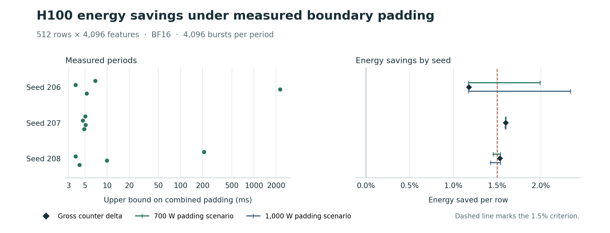

# H100 energy sensitivity over longer fixed-work periods

All three independent timing seeds completed both backend orders with bitwise agreement in both BF16 outputs. Four warps reduced gross energy per row by **1.180–1.599%** with throughput **0.045–0.057% lower**. The 1,000 W sensitivity lower bound cleared 1.5% in seed 207 alone. The campaign fell short of the registered energy adoption criterion. [Machine-readable results](long-window-energy-512-results/summary.json)

## Work and evidence

Both pinned residual RMSNorm kernels process 512 × 4,096 BF16 with eight CUDA streams and 32 independent pairs per stream. Each measured period starts after at least three seconds of warm-up and runs 4,096 bursts for 17,179,869,184 normalized rows. Each seed begins with two opposite backend orders. The first order that loses either endpoint may be repeated once. The complete fixture checks precede each period, and captured outputs and input fingerprints are checked afterward. [Registered protocol](COPY_FREE_LONG_WINDOW_ENERGY_512.md)

The two NVML field timestamps must bracket the completed GPU work. Their conservative padding bounds define an energy sensitivity interval using mean padding-power assumptions of 700 W and 1,000 W. The lower scenario energy is the counter delta minus the assumed contribution of the padding, floored at zero. The upper endpoint is the gross counter delta. For each seed, the comparison uses the two eligible backend orders. The registered criterion requires a saving lower bound of at least 1.5% at 1,000 W and at most 0.5% lower throughput in all three exact timing seeds. [Previous short-window evidence](TIMESTAMPED_NVML_ENERGY_512_REPORT.md)

Seed 205 reproduced both BF16 outputs and passed the eight numerical fixtures. Its 32-burst energy probe processed 134,217,728 normalized rows in 1.467 seconds. The NVML field advanced by 733,420 mJ, with combined padding bounded by 3.191 ms. [Qualification checkpoint](long-window-energy-512-results/s205.json)

## Independent comparisons

| Seed | Eligible pairs | Gross energy saving | 700 W scenario | 1,000 W scenario | Throughput change |
| ---: | :---: | ---: | ---: | ---: | ---: |
| 206 | 2 / 2 | 1.180% | 1.175–1.993% | 1.174–2.341% | −0.045% |
| 207 | 2 / 2 | 1.599% | 1.595–1.602% | 1.594–1.604% | −0.055% |
| 208 | 2 / 2 | 1.533% | 1.458–1.538% | 1.426–1.540% | −0.057% |

All six initial pairs qualified. The closing NVML call in seed 206's final four-warp period took 2.273 seconds. Its 2.274-second padding bound yields an interval that spans the 1.5% target. In seed 208, the longest boundary occurred in the final eight-warp period and was bounded by 209.739 ms. That seed's gross saving was 1.533%. The 1,000 W sensitivity lower bound was 1.426%. All three seeds passed the throughput criterion. [Seed 206 longest boundary](long-window-energy-512-results/s206-p3.json) · [Seed 208 baseline boundary](long-window-energy-512-results/s208-p3.json)



## H100 resource observations

The 12 archived periods completed 206,158,430,208 normalized rows over **2,252.961 seconds** of fixed work, with 36.302 seconds of recorded warm-up. Across the 12 post-query activity snapshots, the median was 100% and the minimum was 0%. The 0% reading followed the longest closing query. Post-query peak power was 525.629 W, maximum temperature was 46 °C and peak device memory usage was 8,431.25 MiB. The device reported a 700 W enforced power limit. These readings come from snapshots outside the measured periods. [Raw device snapshots](long-window-energy-512-results)

## Checkpoint and recovery

Every period has its own result, launch order, original and final input hashes, burst timestamps and two auxiliary snapshots. Seed 206's first period was retrieved from the server cache and matched the local result's canonical SHA-256. The next execution selected the outstanding eight-warp period. [Recovery proof](long-window-energy-512-results/checkpoint-recovery.json) · [Raw checkpoints and attempts](long-window-energy-512-results)

## Follow-up

Keep the eight-warp launch and isolate the input-load cache policy. Compare the existing binary with a candidate that applies Triton's `.cg` cache hint to the activation and residual loads. The next qualification tests instruction differences, both BF16 outputs and input fingerprints before the three independent timing seeds. The throughput gate is 5% in every exact seed. [Registered plan](input-load-cache-512-plan.json) · [Tracking issue](https://github.com/hyscodebase/h100-rmsnorm-lab/issues/58)

## Reproduce

The source revision is `2ef16f1943b732e5627c066ad1ce4bac9e3903be`. Use the recorded PyTorch, Triton and CUDA stack and vLLM comparison asset from the pinned H100 checkpoint. Run one invocation per period on the benchmark host. Each invocation resumes from that state directory.

```bash
BENCH_REVISION=2ef16f1943b732e5627c066ad1ce4bac9e3903be \
  python3 experiments/rmsnorm-residual/vllm/long_window_energy_run.py \
    --asset-dir .lab/vllm-release --state-dir .lab/long-window-energy-512-local
```

Verify the saved archive and regenerate the figure from the analysis branch.

```bash
python3 experiments/rmsnorm-residual/vllm/long_window_energy_report.py
python3 experiments/rmsnorm-residual/vllm/long_window_energy_plot.py
```
