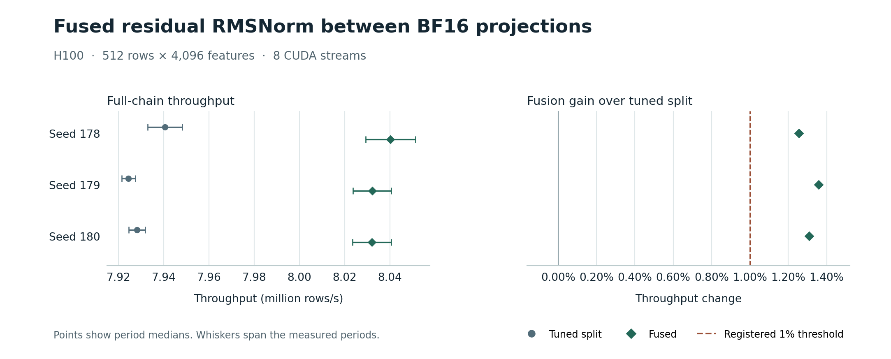

# Residual RMSNorm between BF16 projections on H100

At 512 × 4,096, the fused residual RMSNorm increased full-chain throughput by **1.256–1.359%** over the tuned split in three independent seeds. All three exceeded the registered 1% threshold with bitwise agreement on all four checked outputs. The same residual kernels had a **19.206–19.230%** gap in the isolated benchmark. Both measurements use synthetic inputs and the recorded graph and software stack. [Isolated kernel results](SPLIT_ADD_TILES_512_REPORT.md) · [Raw chain records](projection-chain-512-results)

## Controlled workload

Each path starts with a 512 × 4,096 activation and runs a 4,096 × 4,096 BF16 projection, residual addition and RMSNorm, and a second 4,096 × 4,096 BF16 projection. Both timing paths use `torch.mm` with the same two weights and identical preallocated buffers. They retain the original input and residual, keep four writable arrays per stream, and run 32 disjoint pairs on each of eight CUDA streams. The residual kernels are the 8,192-element split addition with its fixed normalization and the fixed fused direct-output kernel. [Registered protocol](COPY_FREE_PROJECTION_CHAIN_512.md) · [Isolated kernel comparison](SPLIT_ADD_TILES_512_REPORT.md)

Seed 177 compared 536,870,912 BF16 elements per output and per implementation. Both captured paths matched vLLM bitwise at the first projection, the updated residual, the normalized activation and the final projection. Each path preserved 19 input and weight hashes and used the pinned residual binaries in every captured stream. The seed was published before timing. [Qualification commit](https://github.com/hyscodebase/h100-rmsnorm-lab/commit/551a93cc8a5fadb217aa5a3927da616d3ad3f44f) · [Verification output](projection-chain-512-results/s177.json)

## Independent H100 measurements

| Seed | Tuned split (million rows/s) | Fused (million rows/s) | Fusion gain |
| ---: | ---: | ---: | ---: |
| 178 | 7.940477 | 8.040192 | 1.2558% |
| 179 | 7.924407 | 8.032087 | 1.3588% |
| 180 | 7.928180 | 8.031987 | 1.3093% |

Each rate is the median of two balanced periods per backend. Each period began with at least one second of warm-up followed by at least six measured seconds. The eligible workloads passed all four output checks before timing and after every measured period. The original input, residual and weight hashes matched after timing. In each seed even the slower fused period was faster than the faster split period. [Measurement and output evidence](projection-chain-512-results)



## H100 resource observations

The 12 measured periods ran for **75.66 seconds** with 12.55 seconds of recorded warm-up. They completed 36,864 CUDA graph replays and 603,979,776 rows, including repetitions. The fused path delivered 539.0–539.6 effective BF16 GEMM TFLOP/s. That rate counts the operations in both projections and divides by the full elapsed chain time.

The 74 direct NVML samples inside measured windows showed a 100% median GPU activity in all six backend-seed groups. Five groups met the sustained-load coverage criterion. The longest observation gap was 2.500 seconds. Direct NVML recorded peaks of **702.362 W**, **52 °C**, and **12,645.25 MiB** of occupied GPU memory. The supplemental collector recorded 167 GPU-wide observations across the four full attempt windows. [NVML records in each seed](projection-chain-512-results) · [Supplemental observations](projection-chain-512-results/device-samples.json)

The archived seed-178 checkpoint was recovered by a cache-only read and matched its saved canonical digest. The archive also includes all attempt windows and before/after SSH clock probes. [Recovery record](projection-chain-512-results/checkpoint-recovery.json) · [Before probe](projection-chain-512-results/clock-probe-before.json) · [After probe](projection-chain-512-results/clock-probe.json)

## Next experiment

Tripling the downstream projection width to 12,288 doubles the two projections' total GEMM work per row. Keep the residual stage and all other controls fixed, and test whether fusion still clears the 1% threshold. [Registered follow-up](https://github.com/hyscodebase/h100-rmsnorm-lab/issues/44) · [Protocol](COPY_FREE_PROJECTION_TAIL_12288.md)

## Reproduce

Use the relevant H100 and the pinned PyTorch, Triton and released vLLM extension stack. The archived benchmark source revision is `ea2535162f7a2a9afcd5f3d6e73d95bdbc85c83e`. Keep the same cuBLAS workspace setting throughout. [Released extension setup](REPORT.md#reproduce-the-numerical-checkpoint) · [cuBLAS reproducibility](https://docs.nvidia.com/cuda/archive/12.8.1/cublas/index.html#results-reproducibility)

```bash
CUBLAS_WORKSPACE_CONFIG=:4096:8 BENCH_REVISION=ea2535162f7a2a9afcd5f3d6e73d95bdbc85c83e \
  python3 experiments/rmsnorm-residual/vllm/projection_chain_run.py \
    --seed 177 --asset-dir .lab/vllm-release

CUBLAS_WORKSPACE_CONFIG=:4096:8 BENCH_REVISION=ea2535162f7a2a9afcd5f3d6e73d95bdbc85c83e \
  python3 experiments/rmsnorm-residual/vllm/projection_chain_run.py \
    --seed 178 --asset-dir .lab/vllm-release \
    --qualified experiments/rmsnorm-residual/vllm/projection-chain-512-results/s177.json
```

```bash
python3 experiments/rmsnorm-residual/vllm/projection_chain_report.py
python3 experiments/rmsnorm-residual/vllm/projection_chain_plot.py
```
