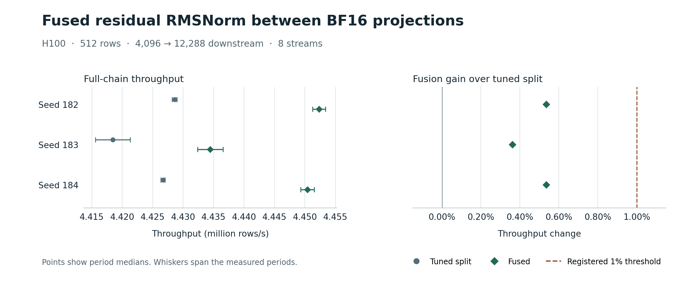

# Residual RMSNorm before a 12,288-column BF16 projection

Fusion increased full-chain throughput by **0.362–0.536%** at 12,288 downstream columns. All three exact independent seeds fell below the registered 1% threshold. The previous 4,096-column comparison reached **1.256–1.359%** using the same residual kernels and residual shape. [Square-chain results](PROJECTION_CHAIN_512_REPORT.md) · [Wide-chain raw results](projection-tail-12288-results)

## Controlled workload

The first projection and residual stage operate on 512 rows × 4,096 features. The second projection uses a 4,096 × 12,288 BF16 weight. It accounts for three quarters of the two projections' GEMM FLOP count. The projections together do twice the GEMM work per row of the square chain and write a wider final output. Both timing paths share preallocated buffers, the two projection weights, the PyTorch GEMM settings and eight CUDA streams. Each stream captures 32 pairs. [Registered protocol](COPY_FREE_PROJECTION_TAIL_12288.md) · [Square projection chain](PROJECTION_CHAIN_512_REPORT.md)

The qualification uses the released vLLM chain as the oracle. It checks the first projection, both residual/RMSNorm outputs and all 12,288 columns of the second projection bitwise. It also checks the original input and weight digests, the disjoint buffer contract, and the 8,192-element split addition, eight-warp normalization and fused kernel hashes in every captured stream. [Numerical and capture records](projection-tail-12288-results)

In seed 181, each candidate matched 1,610,612,736 BF16 values in the wide output and 536,870,912 in each of the other three outputs. Both preserved all 19 input and weight digests. The complete checkpoint was pushed before seed 182 launched. [Qualification commit](https://github.com/hyscodebase/h100-rmsnorm-lab/commit/979f310bcc588843021025140b94d36347420893) · [Seed 181](projection-tail-12288-results/s181.json)

## Independent H100 measurements

| Seed | Tuned split (million rows/s) | Fused (million rows/s) | Fusion gain |
| ---: | ---: | ---: | ---: |
| 182 | 4.428600 | 4.452308 | 0.5353% |
| 183 | 4.418463 | 4.434447 | 0.3617% |
| 184 | 4.426690 | 4.450416 | 0.5360% |

Each rate is the median of two balanced periods per backend, with at least one second of warm-up and six measured seconds per period. Each eligible run passed the complete bitwise comparison before timing and after every measured period. The input and weight digests matched after timing. In every seed the slower fused period still exceeded the faster split period. [Period and exactness evidence](projection-tail-12288-results)



| Downstream columns | Two-projection GEMM FLOPs per row | Fused effective GEMM TFLOP/s | Fusion gain across seeds |
| ---: | ---: | ---: | ---: |
| 4,096 | 67,108,864 | 539.0–539.6 | 1.256–1.359% |
| 12,288 | 134,217,728 | 595.2–597.6 | 0.362–0.536% |

Effective GEMM rate divides both projections' operation count by the elapsed time for the full chain. The wider projection changes both the GEMM shape and the size of the written output. The comparison covers the recorded synthetic graphs.

## H100 resource observations

The 12 measured periods totaled **79.44 seconds**, plus 22.56 seconds of recorded warm-up. They completed 21,504 graph replays and 352,321,536 rows, including repetitions. In all six backend-seed groups, the 78 direct NVML samples had a median device activity of 100%. Five groups met the sustained-load coverage criterion. The longest observation gap was 3.115 seconds. The direct samples recorded peaks of **700.052 W**, **53 °C** and **18,597.25 MiB** of occupied GPU memory. The supplemental collector recorded 178 samples across the four attempt windows. [Supplemental device observations](projection-tail-12288-results/device-samples.json)

Seed 182 was recovered from the remote cache with the same canonical result digest. The archive also contains before/after clock probes and all four attempt windows. [Recovery](projection-tail-12288-results/checkpoint-recovery.json) · [Before probe](projection-tail-12288-results/clock-probe-before.json) · [After probe](projection-tail-12288-results/clock-probe.json)

## Next experiment

At 6,144 downstream columns, the pair does 1.25 times the square-chain GEMM work. That places it near 1% under a simple inverse-work estimate from the square-chain gain. Measure this width with the same kernels and exactness requirements. [Next protocol](COPY_FREE_PROJECTION_TAIL_6144.md) · [Follow-up issue](https://github.com/hyscodebase/h100-rmsnorm-lab/issues/46)

## Reproduce

The benchmark source revision is `0f656ca09a9267204046d639522d7ad9e4ded5a6`. Use the recorded H100 and the same cuBLAS setting, PyTorch and Triton stack, and released vLLM extension as the square chain. [Square chain setup](PROJECTION_CHAIN_512_REPORT.md#reproduce)

```bash
CUBLAS_WORKSPACE_CONFIG=:4096:8 BENCH_REVISION=0f656ca09a9267204046d639522d7ad9e4ded5a6 \
  python3 experiments/rmsnorm-residual/vllm/projection_chain_run.py \
    --downstream-width 12288 --seed 181 --asset-dir .lab/vllm-release

CUBLAS_WORKSPACE_CONFIG=:4096:8 BENCH_REVISION=0f656ca09a9267204046d639522d7ad9e4ded5a6 \
  python3 experiments/rmsnorm-residual/vllm/projection_chain_run.py \
    --downstream-width 12288 --seed 182 --asset-dir .lab/vllm-release \
    --qualified experiments/rmsnorm-residual/vllm/projection-tail-12288-results/s181.json
```

```bash
python3 experiments/rmsnorm-residual/vllm/projection_chain_report.py --downstream-width 12288
python3 experiments/rmsnorm-residual/vllm/projection_chain_plot.py --downstream-width 12288
```
