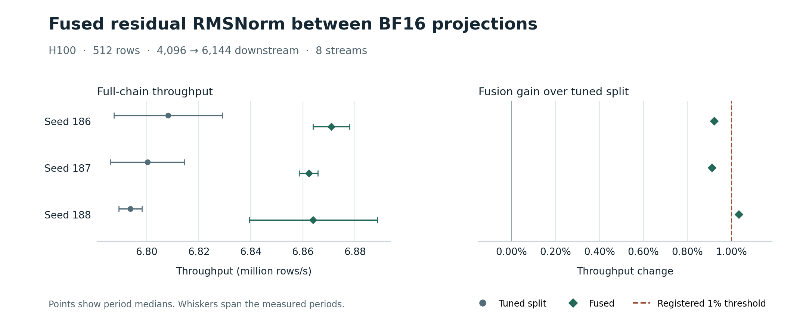

# Residual RMSNorm before a 6,144-column BF16 projection

At 6,144 downstream columns, fusion improved full-chain throughput by **0.911–1.034%** over the tuned split. One of three exact independent seeds cleared the registered 1% threshold. The same residual kernels cleared 1% in every seed at 4,096 downstream columns and fell below 1% in every seed at 12,288 columns. [Square chain](PROJECTION_CHAIN_512_REPORT.md) · [Wide chain](PROJECTION_TAIL_12288_REPORT.md)

## Controlled workload

Each path executes a 512 × 4,096 activation times a 4,096 × 4,096 BF16 weight, residual addition and RMSNorm, then a 4,096 × 6,144 BF16 projection. The two projections account for 83,886,080 GEMM FLOPs per row, 1.25 times the square chain. The timed paths use shared weights and preallocated buffers. They keep the same eight CUDA streams, 32 disjoint pairs per stream, 8,192-element split addition, eight-warp normalization and fused residual kernel. [Registered protocol](COPY_FREE_PROJECTION_TAIL_6144.md) · [Square-chain result](PROJECTION_CHAIN_512_REPORT.md) · [12,288-column result](PROJECTION_TAIL_12288_REPORT.md)

The numerical gate compares the first and second projection results, normalized activation and updated residual against released vLLM inside the chain. It checks all input and weight digests, disjoint writable buffers, and the frozen residual binaries in every captured stream. [Numerical and capture records](projection-tail-6144-results)

Seed 185 matched 805,306,368 BF16 values in the final projection and 536,870,912 values in each of the other outputs per candidate. Both preserved the 19 input and weight hashes. The complete qualification checkpoint was pushed before independent timing. [Qualification commit](https://github.com/hyscodebase/h100-rmsnorm-lab/commit/c4b3783b825c2fa35535ac7c2afbe9a5652b6ce8) · [Seed 185](projection-tail-6144-results/s185.json)

## Independent H100 measurements

| Seed | Tuned split (million rows/s) | Fused (million rows/s) | Fusion gain | Reached 1% |
| ---: | ---: | ---: | ---: | :---: |
| 186 | 6.808226 | 6.870918 | 0.9208% | No |
| 187 | 6.800315 | 6.862252 | 0.9108% | No |
| 188 | 6.793705 | 6.863936 | 1.0338% | Yes |

Each rate is the median of two balanced periods per backend. The two balanced rounds reverse backend order within each seed. The split ran first in seeds 186 and 187, and the fused path ran first in seed 188. Both paths matched all four output tensors bitwise before timing and after every measured period. The original input and weight digests also matched after timing. [Raw periods and exactness checks](projection-tail-6144-results)



| Downstream columns | Two-projection GEMM FLOPs per row | Fused effective GEMM TFLOP/s | Fusion gain across seeds |
| ---: | ---: | ---: | ---: |
| 4,096 | 67,108,864 | 539.0–539.6 | 1.256–1.359% |
| 6,144 | 83,886,080 | 575.6–576.4 | 0.911–1.034% |
| 12,288 | 134,217,728 | 595.2–597.6 | 0.362–0.536% |

Effective GEMM rate divides the operation count of both projections by the full chain elapsed time. The gain decreased across the three measured shapes. Widening the second projection changes both GEMM work and the size of the output. The comparison covers these synthetic CUDA graphs and the pinned stack.

## H100 resource observations

The 12 measured periods totaled **73.66 seconds**, with 14.63 seconds of recorded warm-up. They completed 30,720 graph replays and 503,316,480 rows including repetitions. Across 73 direct NVML samples in measured windows, GPU activity had a median of 100% in all six backend-seed groups. Five groups met the sustained-load coverage criterion. The longest sample gap was 2.129 seconds. Observed device peaks were **700.280 W**, **52 °C** and **14,965.25 MiB** of occupied GPU memory. The supplemental collector recorded 160 samples across the four full attempts. [Supplemental device observations](projection-tail-6144-results/device-samples.json)

Seed 186 was recovered by a cache-only read with an identical digest. The before/after clock probes and attempt windows are archived alongside the timing data. [Recovery record](projection-tail-6144-results/checkpoint-recovery.json) · [Before probe](projection-tail-6144-results/clock-probe-before.json) · [After probe](projection-tail-6144-results/clock-probe.json)

## Next experiment

Try assigning two of vLLM's logical warp groups to each physical warp. Compare the resulting four-warp fused kernel with the existing eight-warp fused path at the same isolated residual shape. The next protocol requires bitwise agreement and at least 5% more isolated throughput in every independent seed before transferring the candidate back into the 6,144-column chain. [Next protocol](COPY_FREE_FOUR_PHYSICAL_WARPS_512.md) · [Tracking issue](https://github.com/hyscodebase/h100-rmsnorm-lab/issues/48)

## Reproduce

Use the H100 and pinned PyTorch, Triton, CUDA and released vLLM extension stack. The frozen measurement code is `25450fd228ac159641535e428c6f4928dfc0d93d`. [Reproduction setup](PROJECTION_CHAIN_512_REPORT.md#reproduce)

```bash
CUBLAS_WORKSPACE_CONFIG=:4096:8 BENCH_REVISION=25450fd228ac159641535e428c6f4928dfc0d93d \
  python3 experiments/rmsnorm-residual/vllm/projection_chain_run.py \
    --downstream-width 6144 --seed 185 --asset-dir .lab/vllm-release

CUBLAS_WORKSPACE_CONFIG=:4096:8 BENCH_REVISION=25450fd228ac159641535e428c6f4928dfc0d93d \
  python3 experiments/rmsnorm-residual/vllm/projection_chain_run.py \
    --downstream-width 6144 --seed 186 --asset-dir .lab/vllm-release \
    --qualified experiments/rmsnorm-residual/vllm/projection-tail-6144-results/s185.json
```

```bash
python3 experiments/rmsnorm-residual/vllm/projection_chain_report.py --downstream-width 6144
python3 experiments/rmsnorm-residual/vllm/projection_chain_plot.py --downstream-width 6144
```
