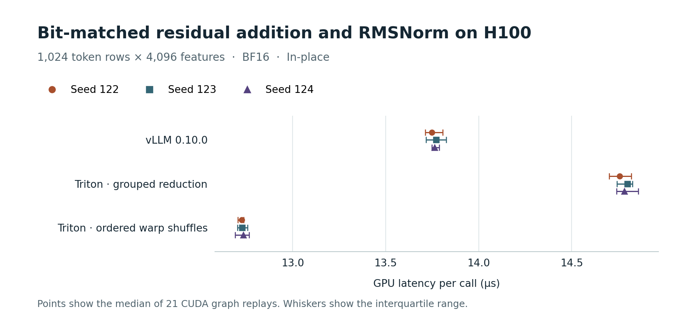

# Ordered warp shuffles for bit-matched residual RMSNorm

**The Triton warp-shuffle kernel reduced latency by 7.43–7.58% against the released vLLM 0.10.0 CUDA operator and by 13.77–14.01% against grouped Triton.** At 1,024 × 4,096, all three timing seeds exceeded the registered 5% vLLM improvement threshold. All five numerical checkpoints passed. The compared output bits agreed on every checked input. [Frozen plan](SHUFFLE_PLAN.md) · [PR #15](https://github.com/hyscodebase/h100-rmsnorm-lab/pull/15)

| Seed | vLLM µs | Grouped Triton µs | Warp-shuffle Triton µs | Reduction against vLLM |
| ---: | ---: | ---: | ---: | ---: |
| [122](shuffle-results/s122.json) | 13.748 | 14.758 | 12.726 | 7.43% |
| [123](shuffle-results/s123.json) | 13.772 | 14.801 | 12.728 | 7.58% |
| [124](shuffle-results/s124.json) | 13.764 | 14.783 | 12.734 | 7.48% |



The three implementations operate in place on matching BF16 inputs and return their updated residual and normalized activation through the designated buffers. The benchmark restores each backend's 32 disjoint buffer pairs on the measurement stream before recording the start event. The 21 randomized replay rounds per seed record 189 original CUDA-event intervals across all three backends. The numbers measure the registered operator on the tested H100 with CUDA 12.8, PyTorch 2.7.1 and Triton 3.3.1. [Timing protocol](bounded_timing.py) · [Released wheel and extension hashes](wheel-record.json)

## Arithmetic and compiler evidence

The kernel keeps the grouped BF16 loads, the two rounding steps and the ordered sum of eight warp totals. The warp path uses five butterfly exchanges with distances 1, 2, 4, 8 and 16. The generated PTX has two vector shared loads and 28 FP32 additions. The grouped program has 128 static shared loads and 271 FP32 additions. Both emit six vector global loads and four vector global stores. The shuffle program records 32 registers per thread, zero spills and a 32-byte statically declared shared array. The logical-lane guard stayed valid on the tested workload. [Kernel source](shuffle_kernel.py) · [Compiler instructions and checksums](shuffle-results/s114.json)

All 47 coordinates that had failed with the original four-warp kernel agree in the grouped and shuffle variants on the same vLLM reference. Across the five-seed campaign, the eight numerical fixtures per seed and three verified sets of 32 calls cover 570,425,344 normalized elements per comparator. Every comparison has zero bit disagreements. Each comparison also checks the exact updated residual encoding, and the dedicated fixtures verify signed zero and rounding before the weight multiply. [All raw runs and attempts](shuffle-results) · [Earlier exactness experiment](GROUPED_REPORT.md)

## Recompute and extend

```bash
python3 experiments/rmsnorm-residual/vllm/shuffle_report.py
python3 experiments/rmsnorm-residual/vllm/shuffle_plot.py
```

The report verifies the frozen Git blobs, identical canonical PTX instructions, graph-event units, seed order and the per-seed decision before plotting. The follow-up tested the vLLM launch change at 256 rows and measured the same candidate at other row counts. [Frozen implementation](https://github.com/hyscodebase/h100-rmsnorm-lab/commit/74ae704) · [Shape study results](TRANSFER_REPORT.md)
