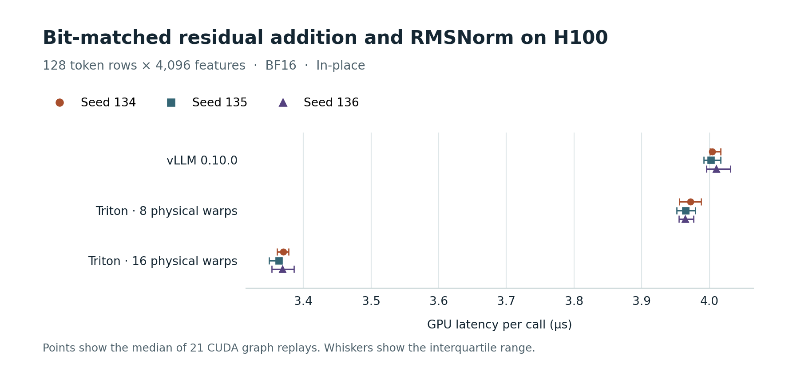

# Sixteen physical warps for 128-row residual RMSNorm

The 128 × 4,096 BF16 kernel assigns one eight-element vector to each of 512 threads. It preserves the 16 ordered FP32 warp totals, the two BF16 rounding steps, and bitwise equality with the released vLLM 0.10.0 operator. The comparison uses the same vLLM extension and checks that the eight-warp baseline's instruction hash matches the previous study. [Registered plan](SMALL_ROWS_16W.md) · [Frozen source](https://github.com/hyscodebase/h100-rmsnorm-lab/commit/e321bb3) · [PR #21](https://github.com/hyscodebase/h100-rmsnorm-lab/pull/21)

## Latency and accuracy

| Seed | vLLM µs | 8-warp Triton µs | 16-warp Triton µs | Lower than vLLM | Lower than 8 warps |
| ---: | ---: | ---: | ---: | ---: | ---: |
| 134 | 4.004 | 3.972 | 3.370 | 15.834% | 15.156% |
| 135 | 4.002 | 3.965 | 3.364 | 15.942% | 15.158% |
| 136 | 4.010 | 3.964 | 3.369 | 15.985% | 15.010% |

The candidate meets the registered 5% latency criterion against both baselines in all three independent timing seeds. Both Triton candidates matched every checked value across 83,886,080 normalized elements per comparator, plus exact stored residuals. The performance result covers this shape and the registered replay workload. The follow-up measured eight-stream throughput and device load. [Sustained workload results](SUSTAINED_128_REPORT.md)



Each of the four checkpoints compared both outputs using eight fixtures and 32 disjoint captured input pairs. The three timing runs record 189 CUDA-event intervals from 21 randomized CUDA Graph replays per backend and 32 in-place calls per replay. Buffer restoration precedes the opening event, and each timed seed has independent random inputs. [Numerical checkpoints and original events](sixteen-warp-results)

The attempt archive includes the two compiler-gate failures and 30 whole-device sensor samples over the six recorded attempt windows. Those samples cover setup and idle time as well as kernels. The read-only recovery check returned the saved seed-133 result byte-for-byte after canonical JSON encoding. The cache retrieval path exits before GPU submission. [Device samples](sixteen-warp-results/device-samples.json) · [Recovery check](sixteen-warp-results/checkpoint-recovery.json)

## Compiler evidence

The first refactor changed the existing eight-warp PTX hash and stopped before comparisons. Restoring the untouched baseline exposed a separate code-generation problem in the 16-warp candidate. Its inferred GPU IR contained four copies of the inline collective and only one produced a value used by the normalization. The fallback that grouped inline inputs in packs of eight still emitted two collectives, with additional layout traffic. [Earlier compiler observations](sixteen-warp-results/compiler-attempts.json)

An explicit Triton GPU IR tile fixes the distribution to 16 physical warps with an eight-value vector in each lane. The SM90 compilation and H100 launcher use the identical binary. Their PTX shows one block barrier, five butterfly shuffles, four vector shared loads, three vector global loads and two vector global stores. The 64-byte static shared array retains the ordered warp totals. Runtime metadata records 32 registers per thread and zero spills. [Explicit layout](sixteen_warp.ttgir.in) · [Static compiler record](sixteen-warp-results/compile-static.json) · [Triton 3.3.1 IR compiler](https://raw.githubusercontent.com/triton-lang/triton/v3.3.1/python/triton/compiler/compiler.py)

## Reproduce

```bash
python3 experiments/rmsnorm-residual/vllm/sixteen_warp_report.py
python3 experiments/rmsnorm-residual/vllm/sixteen_warp_plot.py
```

The verifier checks Git file hashes, the matching offline and H100 binary hashes, both numerical comparisons, and the three-way medians from original CUDA events. To repeat the numerical checkpoint on the same H100, use the pinned Triton and vLLM versions and load the reference extension into the environment. [Wheel preparation](REPORT.md#reproduce-the-numerical-checkpoint)

```bash
BENCH_REVISION=e321bb31e84d47f584e6e2afcddcf06fe90872b3 \
  python3 experiments/rmsnorm-residual/vllm/sixteen_warp_run.py \
    --seed 133 --asset-dir .lab/vllm-release
```
