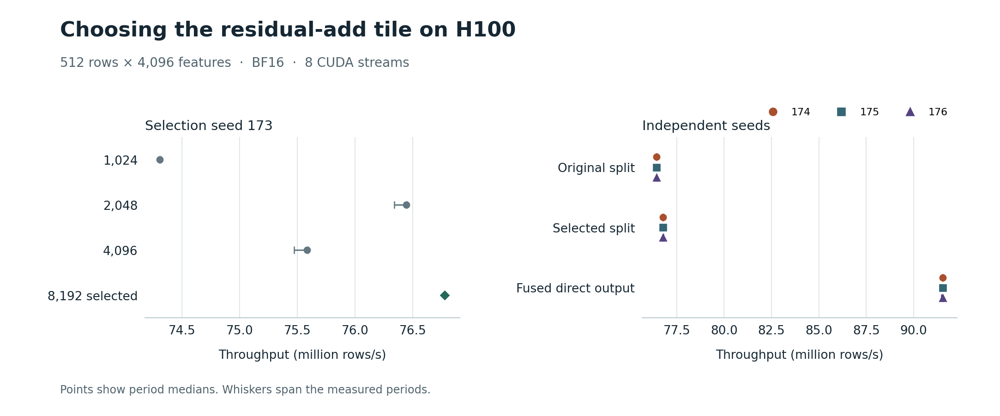

# Split residual-add tile selection at 512 rows

The 8,192-element split addition improved throughput by **0.438–0.453%** over the original 2,048-element tile across three independent seeds. It fell short of the registered 5% threshold, so the default stays at 2,048. Fusion delivered **19.206–19.230%** more throughput than the faster 8,192-element split and matched both BF16 outputs bitwise. The throughput claim applies to the recorded synthetic operator graph. [Raw measurements](split-add-tiles-512-results)

## Controlled workload

At 512 × 4,096 on H100, the four split paths differ only in the number of BF16 elements each four-warp addition block processes. All use the same adjacent add-then-normalize schedule, eight-warp normalization, immutable inputs and writable output addresses. Each of eight CUDA streams keeps 32 independent pairs. Seed 173 selects the tile and seeds 174–176 independently test that choice against the original 2,048-element path. The direct fused kernel provides the performance comparison. [Registered experiment](COPY_FREE_SPLIT_ADD_TILES_512.md) · [Frozen source](https://github.com/hyscodebase/h100-rmsnorm-lab/commit/f1b2e20654f5055bd42738f2971f4fab5ebde6cd)

The verifier checks the original eight numerical fixtures, exact BF16 activation and residual values after poisoned graph replays, disjoint buffer alias guards, and the original activation, residual and weight digests. It checks vector global loads and stores and the pinned 2,048-element addition, normalization and fused identities. The selected addition's compiled identity must match across the tuning and held-out runs. [Numerical and compiler evidence](split-add-tiles-512-results)

## Tile selection

| Elements per addition block | Median throughput (million rows/s) | Registers per thread | 128-bit load/store instructions |
| ---: | ---: | ---: | ---: |
| 1,024 | 74.308 | 22 | 2 / 1 |
| 2,048 | 76.443 | 26 | 4 / 2 |
| 4,096 | 75.585 | 34 | 8 / 4 |
| 8,192 | 76.776 | 52 | 16 / 8 |

All four additions passed exactness and emitted vectorized memory instructions with zero spills. The 8,192-element tile led the original by 0.44% across four balanced seed-173 periods per tile. The selection and full tuning record were pushed before the independent seeds began. [Pre-measurement selection commit](https://github.com/hyscodebase/h100-rmsnorm-lab/commit/79ea73afa84d1614d8045059fe200557cbea185c)

## Independent measurements

| Seed | Original split (million rows/s) | Selected split (million rows/s) | Fused (million rows/s) | Selected gain over original | Fused gain over faster split |
| ---: | ---: | ---: | ---: | ---: | ---: |
| 174 | 76.4374 | 76.7774 | 91.5357 | 0.4449% | 19.2221% |
| 175 | 76.4366 | 76.7716 | 91.5345 | 0.4383% | 19.2297% |
| 176 | 76.4383 | 76.7846 | 91.5319 | 0.4530% | 19.2061% |

Each rate is the median of three balanced periods per backend. Each period lasted at least six measured seconds after at least one second of warm-up. The verifier checks both outputs and the immutable inputs again after timing. It uses the higher of the two split throughputs in each seed for the fused comparison.



## H100 resource observations

The 43 measured periods total **226.83 seconds** of timed replays, comprising 64.38 seconds for tile selection and 162.45 seconds for independent comparisons. They completed 1,106,432 graph replays (18,127,781,888 normalized rows, including repetitions). Recorded warm-up adds 44.42 seconds.

In 205 direct NVML samples inside measured windows, the median device activity was 100% in all 13 backend-seed groups. Eight groups met the registered sustained-load coverage criterion. The largest in-window sampling gap was 2.971 seconds. The observed device peaks were **527.081 W**, **44 °C** and **8,447.25 MiB** of occupied GPU memory. The supplemental collector recorded 351 observations across all four attempt windows. [Direct NVML in each seed](split-add-tiles-512-results) · [Supplemental observations](split-add-tiles-512-results/device-samples.json)

The seed-174 cache-only read returned the same canonical result digest without launching another GPU step. The archive contains all four attempt windows and SSH time probes taken before and after the campaign, so the verifier can reconcile timestamps with the elapsed-time measurements. [Recovery record](split-add-tiles-512-results/checkpoint-recovery.json) · [Before probe](split-add-tiles-512-results/clock-probe-before.json) · [After probe](split-add-tiles-512-results/clock-probe.json)

## Next experiment

Keep the faster 8,192-element split as a demanding comparison and test both kernels between two BF16 projections at the same shape. The next experiment checks the projected output bitwise and requires a 1% throughput improvement in each independent seed before calling the gain reproducible in the chain. [Registered projection-chain experiment](https://github.com/hyscodebase/h100-rmsnorm-lab/issues/42) · [Protocol](COPY_FREE_PROJECTION_CHAIN_512.md)

## Reproduce

```bash
python3 experiments/rmsnorm-residual/vllm/split_add_tuning_report.py
python3 experiments/rmsnorm-residual/vllm/split_add_tuning_plot.py
```

Use the recorded H100 and vLLM extension stack for measurements. Give each independent timing invocation the original seed-173 JSON with `--qualified`. [Setup for the released extension](REPORT.md#reproduce-the-numerical-checkpoint)

```bash
BENCH_REVISION=f1b2e20654f5055bd42738f2971f4fab5ebde6cd \
  python3 experiments/rmsnorm-residual/vllm/split_add_tuning_run.py \
    --seed 173 --asset-dir .lab/vllm-release

BENCH_REVISION=f1b2e20654f5055bd42738f2971f4fab5ebde6cd \
  python3 experiments/rmsnorm-residual/vllm/split_add_tuning_run.py \
    --seed 174 --asset-dir .lab/vllm-release \
    --qualified experiments/rmsnorm-residual/vllm/split-add-tiles-512-results/s173.json
```
