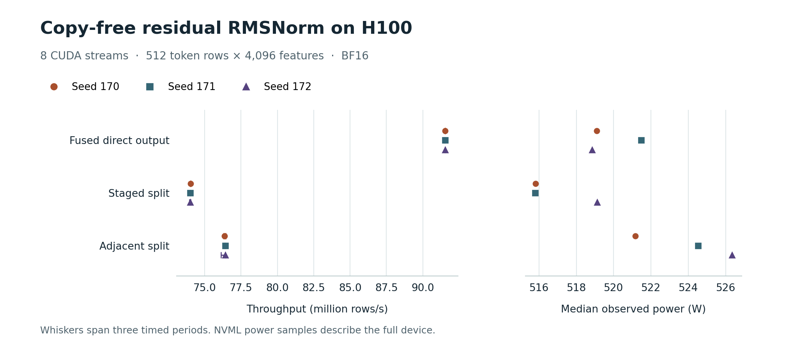

# Split residual RMSNorm scheduling at 512 rows

The adjacent split graph delivered **3.18–3.26% more throughput** than the staged split graph at 512 × 4,096. The three seeds stayed below the registered 5% threshold. Direct fusion delivered 19.75–19.85% more throughput than the adjacent split graph.

## One graph order changes

At 512 × 4,096 on H100, the adjacent graph launches an addition and then normalization for every pair. The staged graph launches all 32 additions and then the 32 normalizations. Each stream executes the same 64 kernel launches and uses the same 32 disjoint BF16 pairs, source hashes and writable output locations. The add-to-normalize distance changes from one to 32 positions per stream. Direct fusion provides a throughput reference. [Registered workload](COPY_FREE_SPLIT_SCHEDULE_512.md) · [Frozen source](https://github.com/hyscodebase/h100-rmsnorm-lab/commit/820cb56eaad440f0947b311cd06a67739311220a)

Seed 169 verified both outputs after poisoning the writable buffers and replaying each recorded graph. It also verified the original source and weight digests and the output alias guards. The launch records checked both split schedules and the compiled binaries for all eight streams against the original 512-row checkpoint. [Accuracy and kernel evidence](split-schedule-512-results/s169.json)

This experiment measures how launch order affects throughput. The separate hardware-counter qualification recorded the host's counter-access rejection. [Nsight qualification](COPY_FREE_MEMORY_512_QUALIFICATION.md)

## Throughput

| Seed | Fused direct output | Staged split | Adjacent split | Adjacent gain over staged |
| ---: | ---: | ---: | ---: | ---: |
| 170 | 91.545 | 74.030 | 76.381 | +3.176% |
| 171 | 91.530 | 74.019 | 76.434 | +3.262% |
| 172 | 91.532 | 74.024 | 76.426 | +3.245% |

Each number is the median wall throughput of three balanced periods per backend and seed in millions of normalized rows per second. In each of eight streams, the graph processes 32 pairs and each burst replays 32 graphs. Both exact outputs matched again after every timed period and the original input and weight hashes matched at completion. [Raw timing, graph orders and numerical checks](split-schedule-512-results)



## H100 use and coverage

The measured 27 periods took **162.403 seconds** and completed 13,094,617,088 normalized rows. The archive includes 3,122 timed and 531 warm-up CUDA-event intervals. Direct NVML returned 152 in-window GPU activity samples. All nine backend-seed groups had a 100% activity median. Six met the coverage and sustained activity criteria. The longest gap was 2.565 seconds.

| Backend | In-window activity samples per seed | Median GPU activity | Seed median power range | Peak power |
| --- | ---: | ---: | ---: | ---: |
| Fused direct output | 14–18 | 100% | 518.8–521.5 W | 524.4 W |
| Staged split | 17–18 | 100% | 515.8–519.1 W | 521.2 W |
| Adjacent split | 16–18 | 100% | 521.2–526.3 W | 527.3 W |

The peak device readings were 7,991.25 MiB of VRAM and 45 °C. The SSH observer retained 294 supplemental samples across the four attempt windows. Seed 170 matched a cache-only retrieval by canonical JSON SHA-256. [Supplemental samples](split-schedule-512-results/device-samples.json) · [Recovery proof](split-schedule-512-results/checkpoint-recovery.json)

The preceding experiment's probes bounded the H100 clock roughly two seconds ahead of the local clock. The post-run probes here put the offset within 0.03 seconds of zero. The UTC attempt records fit offsets within the span of those observations. The verifier also checks that the GPU-host monotonic execution time fits within each local monotonic attempt. All throughput intervals and direct NVML assignments use the H100's own monotonic clock. [Earlier clock exchanges](copy-free-512-results/clock-probe.json) · [Post-run clock exchanges](split-schedule-512-results/clock-probe.json)

## Reproduce

```bash
python3 experiments/rmsnorm-residual/vllm/split_schedule_report.py
python3 experiments/rmsnorm-residual/vllm/split_schedule_plot.py
```

Use the recorded H100 stack and vLLM extension for the exact-output check. A timing seed also requires the saved seed-169 record as `--qualified`. [Extension setup](REPORT.md#reproduce-the-numerical-checkpoint)

```bash
BENCH_REVISION=820cb56eaad440f0947b311cd06a67739311220a \
  python3 experiments/rmsnorm-residual/vllm/split_schedule_run.py \
    --seed 169 --asset-dir .lab/vllm-release
```

The next experiment compares four addition tile sizes and tests the fastest exact split path on independent seeds. [Addition tile protocol](COPY_FREE_SPLIT_ADD_TILES_512.md) · [Tracking issue](https://github.com/hyscodebase/h100-rmsnorm-lab/issues/40)
