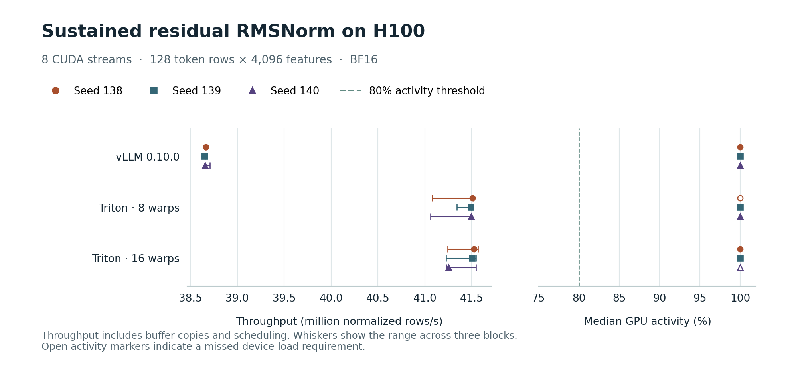

# Sustained eight-stream residual RMSNorm on H100

The workload uses 128 × 4,096 BF16 activations per call and eight CUDA streams. Each graph restores two buffers and then executes 32 in-place calls. Its throughput measures normalized rows per second from host enqueue to the synchronization after all eight streams finish. The experiment compares released vLLM 0.10.0, the bit-matched eight-warp kernel and the 16-warp kernel on the same H100. [Registered protocol](SUSTAINED_128.md) · [Frozen commit](https://github.com/hyscodebase/h100-rmsnorm-lab/commit/b97a65b) · [PR #23](https://github.com/hyscodebase/h100-rmsnorm-lab/pull/23)

## Throughput

| Seed | vLLM | Triton 8 warps | Triton 16 warps | 16 warps vs vLLM | 16 warps vs 8 warps |
| ---: | ---: | ---: | ---: | ---: | ---: |
| 138 | 38.663 | 41.509 | 41.526 | +7.405% | +0.040% |
| 139 | 38.652 | 41.491 | 41.504 | +7.377% | +0.030% |
| 140 | 38.657 | 41.494 | 41.254 | +6.718% | −0.578% |

Each rate is the median of three measured blocks in millions of normalized rows per second. Sixteen warps met the 5% threshold against vLLM in all three seeds. It missed the threshold against eight warps in each seed, so this workload does not meet the registered adoption criterion. The 27 measured blocks lasted 162.355 seconds and completed 6,572,474,368 normalized rows, including repeated graph inputs. The archive also retains 6,268 coordinated measurement bursts and 1,053 warm-up bursts. [Separate copy and operator results](COPY_SPLIT_REPORT.md)



The 256 disjoint pairs per backend reused identical buffer addresses across methods. All three implementations passed the eight numerical fixtures, including the signed-zero and weight probes, and output checks for every pair in all four checkpoints. Each timed block also rechecked both outputs after its final completed burst. The input and weight digests matched at each verification boundary. The saved seed-138 result was retrieved from the remote cache with a matching canonical hash. [Raw numerical checks and original window intervals](sustained-results) · [Recovery check](sustained-results/checkpoint-recovery.json)

## Device observation

| Backend | In-window samples per seed | Median GPU activity | Median memory activity | Largest gap | High-load seeds | Peak NVML power |
| --- | ---: | ---: | ---: | ---: | ---: | ---: |
| vLLM | 17–18 | 100% | 96% | 1.256 s | 3/3 | 489.915 W |
| Triton 8 warps | 15–18 | 100% | 100% | 2.440 s | 2/3 | 478.185 W |
| Triton 16 warps | 14–17 | 100% | 100% | 2.260 s | 2/3 | 483.159 W |

Direct NVML provided 151 valid GPU activity samples inside measured blocks. The median was 100% for all nine backend-seed groups. The 8-warp seed 138 and the 16-warp seed 140 each exceeded the two-second gap criterion, giving seven of nine qualified groups. The in-window NVML readings reached 3,055.25 MiB VRAM, 43 °C and 489.915 W. The SSH-based device observer provided 195 samples spanning setup, execution and cleanup, with a 2,492 MiB peak reading. The PyTorch allocator recorded a peak allocation of 1,680.02 MiB. [Supporting device samples](sustained-results/device-samples.json)

NVML GPU activity describes the fraction of a sample period during which at least one kernel executes. Memory activity describes the fraction with device-memory reads or writes. The recorded memory-activity percentages characterize time with traffic. A bandwidth estimate also requires a byte count. Sample membership and the inclusive observation gaps are recomputed from the original monotonic timestamps. [NVML utilization fields](https://docs.nvidia.com/deploy/nvml-api/620/api/structnvmlUtilization__t.html) · [CUDA Graph replay code](https://raw.githubusercontent.com/pytorch/pytorch/v2.7.1/aten/src/ATen/cuda/CUDAGraph.cpp)

## Reproduction

```bash
python3 experiments/rmsnorm-residual/vllm/sustained_report.py
python3 experiments/rmsnorm-residual/vllm/sustained_plot.py
```

The verifier checks the frozen Git source bytes, both candidate binaries, the numerical records, the balanced schedule and every burst and NVML slot. To repeat one checkpoint, use the recorded H100 stack and the pinned vLLM extension. Supply the saved seed-137 checkpoint as `--qualified` when requesting a timing seed. [vLLM extension setup](REPORT.md#reproduce-the-numerical-checkpoint)

```bash
BENCH_REVISION=b97a65b8e61d175765ccc3b8bde7e9cc29faa46c \
  python3 experiments/rmsnorm-residual/vllm/sustained_run.py \
    --seed 137 --asset-dir .lab/vllm-release
```
