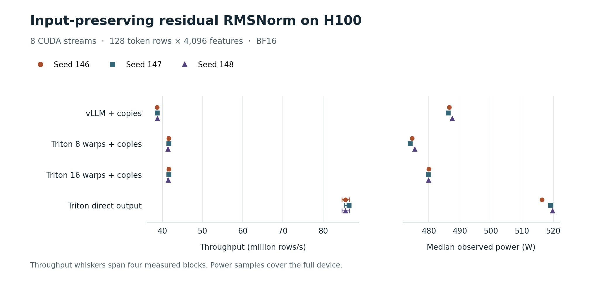

# Input-preserving residual RMSNorm with direct outputs

The four backends take the same immutable BF16 activation, residual and weight inputs and produce the normalized activation and updated residual in the same writable addresses. The released vLLM 0.10.0 operator and both frozen Triton in-place operators restore both input tensors before the operator. The new 16-warp graph reads the sources directly and writes the two outputs. Each graph processes 32 pairs at 128 × 4,096, and each coordinated burst replays it 32 times per stream on eight CUDA streams. [Registered workload](SUSTAINED_OUT_OF_PLACE.md) · [Frozen implementation](https://github.com/hyscodebase/h100-rmsnorm-lab/commit/a3bbcba)

## Throughput

| Seed | vLLM + copies | 8 warps + copies | 16 warps + copies | Direct output | Gain over fastest baseline |
| ---: | ---: | ---: | ---: | ---: | ---: |
| 146 | 38.666 | 41.546 | 41.564 | 85.572 | +105.879% |
| 147 | 38.634 | 41.545 | 41.561 | 86.463 | +108.037% |
| 148 | 38.683 | 41.327 | 41.399 | 85.583 | +106.725% |

Each rate is the median of four measured blocks in millions of normalized rows per second. Direct output reached 2.059–2.080 times the fastest baseline and cleared the registered 5% threshold against all three baselines in each seed. Compared with released vLLM plus restoration, the per-seed throughput gains were 121.242–123.799%. The decision applies to the same immutable inputs and two-output workload. The follow-up compares a second implementation that also avoids restoration copies. [Copy-free fusion plan](COPY_FREE_FUSION.md)



Each seed first checks the eight numerical fixtures, including signed zero and weight rounding. After poisoning the writable buffers, it compares both outputs on all 256 input pairs against vLLM and hashes both sources and the weight after each backend. The alias checks reject each output overlapping a source or the other output. The two outputs match again after every timed block. All conditions share the same output addresses. The fixture adapter copies inputs to exercise the existing oracle. The recorded timing graph uses the direct output launcher. [Original numerical and timing checkpoints](out-of-place-results)

## Code generation and device observations

The shared TTGIR still renders the original in-place program byte-for-byte. The out-of-place path retains the 512-thread block, ordered FP32 sum, one CTA barrier and both BF16 rounding steps. The new PTX uses three vector global loads, two vector global stores, 32 registers per thread and no spills. The graph avoids 64 MiB of restoration payload per stream replay, or 512 MiB across eight stream graphs. Those byte counts describe the explicit copies in the baseline graph. [TTGIR template](sixteen_warp.ttgir.in) · [Compiler captures](out-of-place-results)

The 48 measured blocks took 192.490 seconds and completed 9,974,054,912 normalized rows, including repeated graph inputs. The archive retains 9,512 measured CUDA-event intervals and 2,390 warm-up intervals.

| Backend | In-window NVML samples per seed | Median GPU activity | Median power across seeds | Peak power |
| --- | ---: | ---: | ---: | ---: |
| vLLM + copies | 15–17 | 100% | 486.2–487.5 W | 491.2 W |
| Triton 8 warps + copies | 13–16 | 100% | 473.9–475.4 W | 478.8 W |
| Triton 16 warps + copies | 14–16 | 100% | 479.7–479.9 W | 484.3 W |
| Triton direct output | 12–16 | 100% | 516.4–519.7 W | 525.5 W |

Direct NVML returned 182 valid in-window GPU activity samples. All twelve backend-seed groups reached a 100% median and four groups had sample gaps above two seconds. The largest gap was 2.402 seconds. The highest in-window readings reached 3,057.25 MiB of device memory and 44 °C. The SSH observer retained another 265 samples over the four submissions. A cache-only retrieval of seed 146 matched the saved checkpoint after canonical JSON encoding. [Device records](out-of-place-results/device-samples.json) · [Recovery check](out-of-place-results/checkpoint-recovery.json)

## Reproduce

```bash
python3 experiments/rmsnorm-residual/vllm/out_of_place_report.py
python3 experiments/rmsnorm-residual/vllm/out_of_place_plot.py
```

The verifier checks the frozen inputs, extension, compiled binaries, original wall and CUDA intervals, per-seed decisions and NVML coverage. To rerun the accuracy checkpoint, prepare the same H100 stack and released extension. Supply the saved seed-145 checkpoint as `--qualified` for a timing seed. [Extension setup](REPORT.md#reproduce-the-numerical-checkpoint)

```bash
BENCH_REVISION=a3bbcba60ea1d2dcf2c75063510040fb6be7d5b4 \
  python3 experiments/rmsnorm-residual/vllm/out_of_place_run.py \
    --seed 145 --asset-dir .lab/vllm-release
```
