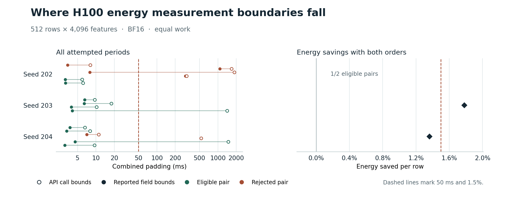

# Timestamped NVML energy windows on H100

The NVML field times resolved three long opening calls to less than 8 ms of combined padding per period. Slow closing calls still excluded three periods. Two independent seeds supplied both eligible orders and showed **1.360–1.779% lower energy per row** with four warps. Only seed 203 reached the 1.5% energy threshold, and seed 202 supplied one eligible order. The registered three-seed acceptance criterion was unmet. [Raw checkpoints](timestamped-nvml-energy-512-results)

## Work and measurement

The two frozen residual RMSNorm kernels run at 512 × 4,096 BF16. Eight CUDA streams each capture 32 disjoint pairs, with outputs written directly. A measured period starts after at least three seconds of warm-up and completes 512 bursts for 2,147,483,648 normalized rows. The verifier checks both compiled binaries, both BF16 outputs and every input and weight digest. Each seed attempts both backend orders. A first rejected pair can be repeated once in its original order. [Registered protocol](COPY_FREE_TIMESTAMPED_NVML_ENERGY_512.md) · [Previous short-boundary comparison](ENERGY_COUNTER_BOUNDARIES_512_REPORT.md)

NVML field 83 returns cumulative board energy in millijoules and a CPU epoch timestamp. Four realtime readings bracketed by monotonic calls establish the conversion bounds. The field intervals must enclose the completed work with at most 50 ms of combined padding. The analysis uses the CPU sample timestamps and records the API call boundaries and field update latencies separately. [NVML energy field](https://docs.nvidia.com/deploy/archive/R550/nvml-api/group__nvmlFieldValueEnums.html) · [Timestamp and latency fields](https://docs.nvidia.com/deploy/archive/R550/nvml-api/structnvmlFieldValue__t.html)

Seed 201 passed all eight numerical fixtures and matched the two outputs after graph replay. Both field calls succeeded and returned unsigned 64-bit millijoules. The cumulative counter advanced by 724,758 mJ over the probe of 134,217,728 normalized rows and 1.466 seconds. The upper padding bound was 3.318 ms using the field timestamps. The API bracket for that same probe added 8.612 ms. [Qualification commit](https://github.com/hyscodebase/h100-rmsnorm-lab/commit/fc161f5) · [Seed 201 raw checkpoint](timestamped-nvml-energy-512-results/s201.json)

## Independent comparisons

| Seed | Eligible / attempted pairs | Max field padding (ms) | Max API padding (ms) | Eight warps (J/billion rows) | Four warps (J/billion rows) | Energy saved | Throughput change |
| ---: | :---: | ---: | ---: | ---: | ---: | ---: | ---: |
| 202 | 1 / 3 | 1,077.199 | 1,858.986 | — | — | Incomplete | — |
| 203 | 2 / 2 | 6.530 | 1,421.437 | 5,692.77 | 5,591.49 | 1.7790% | −0.0613% |
| 204 | 2 / 3 | 530.691 | 1,482.416 | 5,699.80 | 5,622.28 | 1.3599% | −0.0689% |

Maxima cover all attempts, including invalid periods. All periods in eligible pairs stayed within 6.530 ms of field padding. Both BF16 outputs matched after every attempted period. Input and weight digests matched before and after timing in each seed. The throughput criterion was met in both complete comparisons.



## What the field timestamps changed

An opening query in seed 202 took 1,851.056 ms. Using the call endpoints would give 1,858.986 ms of padding. The returned field times bound the padding to 7.938 ms and qualify that period. The opposite backend in its pair still failed because the closing query took 295.341 ms. The other original pair failed with a closing query of 1,076.897 ms. Its permitted repeat qualified, leaving the seed with one complete order. [Seed 202 calls, field times and repeat](timestamped-nvml-energy-512-results/s202.json)

An opening query in seed 203 took 1,417.373 ms. The field times bounded that period's padding to 4.096 ms. Both pairs qualified, so this seed provides a complete comparison even though one call exceeded the 50 ms cutoff. The reported timestamp describes a CPU-side observation. The physical integration interval of the energy sensor is outside the experiment's observations. [Seed 203 raw field records](timestamped-nvml-energy-512-results/s203.json)

Seed 204's first attempt at the four-warp-first order exceeded the limit with a 530.542 ms closing call. The repeat qualified even with a 1,477.911 ms opening call. Its field padding was 4.536 ms. Across all three seeds, six attempted periods exceeded the 50 ms limit when computed from the same API call brackets. Three exceeded it when computed from the field times. [Seed 204 calls and retry](timestamped-nvml-energy-512-results/s204.json)

## H100 resource observations

The eight attempted pairs completed **375.50 seconds** of fixed work and 48.40 seconds of recorded warm-up. They processed 34,359,738,368 normalized rows including repeats. The five eligible pairs contributed 234.69 seconds and 21,474,836,480 rows, including seed 202's one complete pair.

The 16 post-query snapshots had a GPU activity median of 100%, a peak of 525.841 W and maxima of 46 °C and 8,431.25 MiB of GPU memory. The 16 pre-warm-up snapshots and the post-query ones describe their specific sampling points around each period.

The archive retains each attempted period and the associated before-warm-up and post-query snapshots. Local monotonic attempts, the two SSH clock probes and a cache-only read of seed 203 provide a recovery record. The saved and retrieved checkpoints have the same canonical digest. [Raw checkpoints and attempts](timestamped-nvml-energy-512-results) · [Recovery proof](timestamped-nvml-energy-512-results/checkpoint-recovery.json)

## Next experiment

Run longer equal-work periods with one resumable period per GPU submission. Quantify how measured padding affects the estimated saving at two stated power assumptions. The next protocol requires a lower bound of at least 1.5% energy savings and at most 0.5% lower throughput in all three complete, exact seeds. [Follow-up plan](COPY_FREE_LONG_WINDOW_ENERGY_512.md) · [Tracking issue](https://github.com/hyscodebase/h100-rmsnorm-lab/issues/56)

## Reproduce

Use H100 and source revision `cf1c3801f3172685d83f4b907e74444a11e9fb14` with the recorded PyTorch, Triton, CUDA and released vLLM comparison asset. [vLLM extension setup](REPORT.md#reproduce-the-numerical-checkpoint)

```bash
BENCH_REVISION=cf1c3801f3172685d83f4b907e74444a11e9fb14 \
  python3 experiments/rmsnorm-residual/vllm/timestamped_nvml_energy_run.py \
    --seed 201 --asset-dir .lab/vllm-release

BENCH_REVISION=cf1c3801f3172685d83f4b907e74444a11e9fb14 \
  python3 experiments/rmsnorm-residual/vllm/timestamped_nvml_energy_run.py \
    --seed 202 --asset-dir .lab/vllm-release \
    --qualified experiments/rmsnorm-residual/vllm/timestamped-nvml-energy-512-results/s201.json
```

```bash
python3 experiments/rmsnorm-residual/vllm/timestamped_nvml_energy_report.py
python3 experiments/rmsnorm-residual/vllm/timestamped_nvml_energy_plot.py
```
