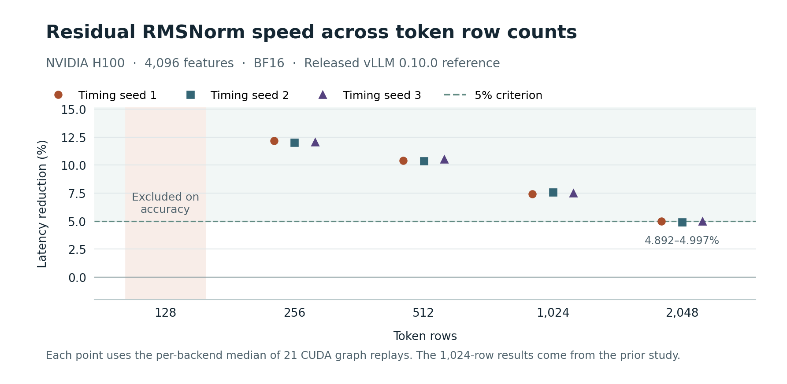

# H100 residual RMSNorm across the vLLM row-count boundary

This study holds hidden width at 4,096 and reuses the ordered warp-shuffle kernel from the 1,024-row comparison. It preregisters four new input sizes against the same released vLLM 0.10.0 CUDA binary. Each shape has one numerical preflight and up to three independent timing seeds. A timed seed must pass all eight fixtures and all 32 captured input pairs. A shape meets the latency criterion only when all three seeds show a reduction of at least 5%. [Registered protocol](ROW_TRANSFER.md) · [Frozen source](https://github.com/hyscodebase/h100-rmsnorm-lab/commit/f6c1018) · [PR #17](https://github.com/hyscodebase/h100-rmsnorm-lab/pull/17)

## Latency and exactness

The elapsed-time entries are ranges of per-seed medians across the three processes. CUDA events time 21 randomized replay rounds with 32 in-place calls per graph. Each backend starts with the same BF16 values in disjoint input pairs, and the benchmark restores both buffers before the opening event.

| Token rows | vLLM µs | Triton µs | Latency reduction | 5% criterion |
| ---: | ---: | ---: | ---: | --- |
| 128 | — | — | — | Excluded by accuracy |
| 256 | 5.573–5.589 | 4.900–4.917 | 12.02–12.18% | 3/3 seeds |
| 512 | 8.199–8.206 | 7.337–7.353 | 10.38–10.51% | 3/3 seeds |
| 1,024 ([prior study](SHUFFLE_REPORT.md)) | 13.748–13.772 | 12.726–12.734 | 7.43–7.58% | 3/3 seeds |
| 2,048 | 25.591–25.614 | 24.333–24.341 | 4.892–4.997% | 0/3 seeds |



The three new shapes at and above 256 rows had zero bit disagreements across 1,476,395,008 compared normalized elements. All passing cases also checked the stored residual exactly. The 2,048-row shape was faster in each seed and stayed below the registered 5% threshold in each seed. This comparison measures the operator on the tested H100 within the registered CUDA Graph workload.

### Why 128 rows produced no latency estimate

The 128-row preflight and the eight standard fixtures in each timing seed matched bitwise. The capture-input checks found 238 differing BF16 activations across eight input pairs, of which 126 failed the preregistered numerical gate. The same checks verified the stored residual for both implementations. Each of the three seeds stopped before collecting CUDA events. [Seed 126](transfer-results/r128-s126.json) · [Seed 127](transfer-results/r128-s127.json) · [Seed 128](transfer-results/r128-s128.json)

At this width, released vLLM selects 1,024 threads per block below 256 rows and 256 threads from that boundary onward. The candidate has the same canonical PTX instruction hash across all measured shapes. The follow-up kept the two groups separate until after the warp reduction and resolved all checked bit disagreements at 128 rows. [Released CUDA source](https://raw.githubusercontent.com/vllm-project/vllm/v0.10.0/csrc/layernorm_kernels.cu) · [Follow-up result](SMALL_ROWS_REPORT.md)

## Evidence and reproduction

The 16 checkpoints preserve both numerical output checks, the 378 original CUDA event intervals from successful timing seeds, execution times, compiler instructions, runtime versions and file hashes. [Raw checkpoints and attempts](transfer-results)

The device observer returned 149 samples across 16 attempt windows. In those samples, the observed peaks were 24% GPU use, 1,554 MiB VRAM and 166.36 W. The 512-row seed-127 attempt contributed 97 samples, including the long wait before the benchmark started. The nominal one-second sampler covers whole-device activity during each attempt, including setup and idle time. The CUDA event intervals separately measure the timed work. [Device samples](transfer-results/device-samples.json)

```bash
python3 experiments/rmsnorm-residual/vllm/transfer_report.py
python3 experiments/rmsnorm-residual/vllm/transfer_plot.py
```

The first command verifies the frozen Git objects and reproduces the numerical counts and event medians without a GPU. To run one checkpoint on the recorded GPU and software, prepare the same pinned vLLM extension and pass the archived shape-specific preflight when requesting a timing seed. In this history, the recorded source files remain identical to the frozen revision. [Reference wheel setup](REPORT.md#reproduce-the-numerical-checkpoint)

```bash
BENCH_REVISION=f6c1018fc6885622b65ab3cd16d52f002984905d \
  python3 experiments/rmsnorm-residual/vllm/row_transfer.py --rows 256 --seed 126 \
    --asset-dir .lab/vllm-release \
    --baseline experiments/rmsnorm-residual/vllm/shuffle-results/s114.json \
    --qualified experiments/rmsnorm-residual/vllm/transfer-results/r256-s125.json
```
